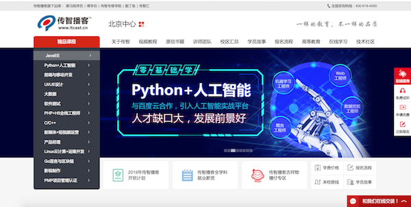

# html 的介绍

**学习目标**

-   能够知道html的作用

* * *

### 1\. 网页效果图 -- 传智播客首页

### 2\. html的定义

HTML 的全称为：HyperText Mark-up Language, 指的是超文本标记语言。 标记：就是标签, `<标签名称> </标签名称>`, 比如: `<html></html>、<h1></h1>` 等，标签大多数都是成对出现的。

所谓超文本，有两层含义:

1.  因为网页中还可以图片、视频、音频等内容(超越文本限制)
2.  它还可以在网页中跳转到另一个网页，与世界各地主机的网页链接(超链接文本)

### 3\. html的作用

html是用来开发网页的，它是开发网页的语言。

### 4\. 小结

-   html是开发网页的语言
-   html中的标签大多数都是成对出现的, 格式: `<标签名></标签名>`
