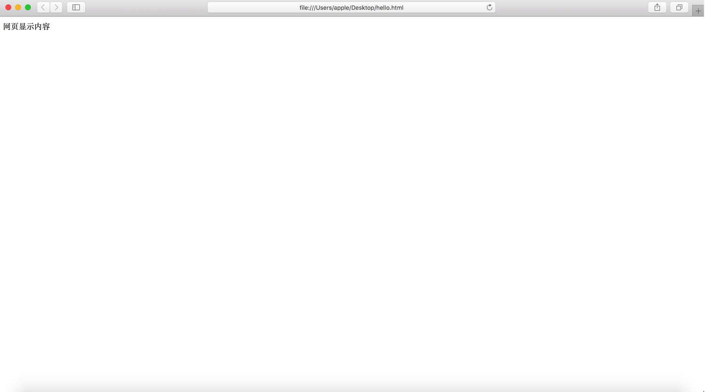
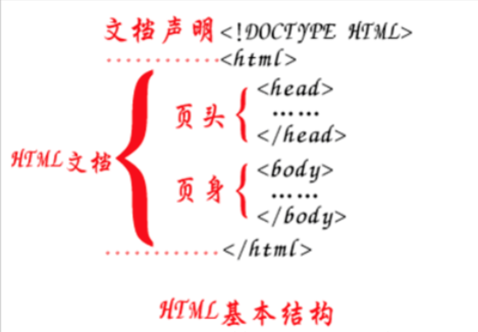

# html 的基本结构

**学习目标**

-   能够写出html的基本结构

### 1\. 结构代码

```html

                
        
        网页标题
    
    
          网页显示内容
    

```

1.  第一行`<!DOCTYPE html>`是文档声明, 用来指定页面所使用的html的版本, 这里声明的是一个html5的文档。
2.  `<html>...</html>`标签是开发人员在告诉浏览器，整个网页是从`<html>`这里开始的，到`<html>`结束,也就是html文档的开始和结束标签。
3.  `<head>...</head>`标签用于定义文档的头部,是负责对网页进行设置标题、编码格式以及引入css和js文件的。
4.  `<body>...</body>`标签是编写网页上显示的内容。

### 2\. 浏览网页文件

网页文件的后缀是**.html**或者**.htm**, **一个html文件就是一个网页**，html文件用编辑器打开显示的是文本，可以用文本的方式编辑它，如果用浏览器打开，浏览器会按照标签描述内容将文件渲染成网页。



### 3\. 小结


