# vscode 的基本使用

**学习目标**

-   能够安装和卸载 vscode 的插件
-   能够设置 vscode 的颜色主题和字体大小

* * *

### 1\. vscode 的基本介绍

全拼是 Visual Studio Code (简称 VS Code) 是由微软研发的一款免费、开源的跨平台**代码编辑器**，目前是前端(网页)开发使用最多的一款软件开发工具。

### 2\. vscode 的安装

1.  下载网址: [https://code.visualstudio.com/Download](https://code.visualstudio.com/Download)
2.  选择对应的安装包进行下载: 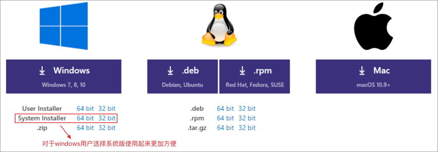
3.  根据下载的安装包双击进行安装即可，当然为了更好的使用 vscode 还可以安装对应的插件。

### 3\. vscode 的插件安装

<html><head></head><body><table><thead><tr><th style="text-align:center">插件名</th><th style="text-align:center">说明</th></tr></thead><tbody><tr><td style="text-align:center">Chinese (Simplified) Language Pack for VS Code</td><td style="text-align:center">中文(简体)汉化包</td></tr><tr><td style="text-align:center">open in browser</td><td style="text-align:center">右击在浏览器打开html</td></tr></tbody></table></body></html>

1.  汉化插件安装 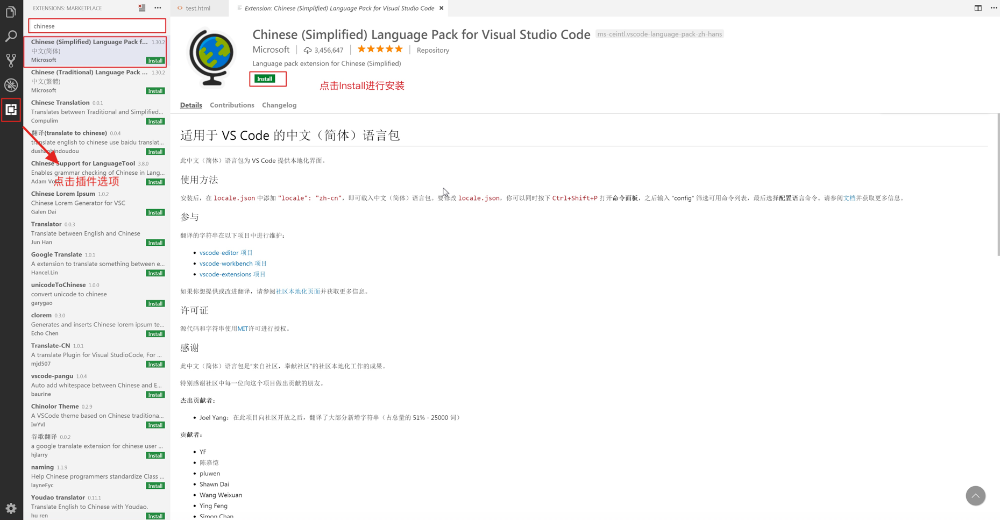 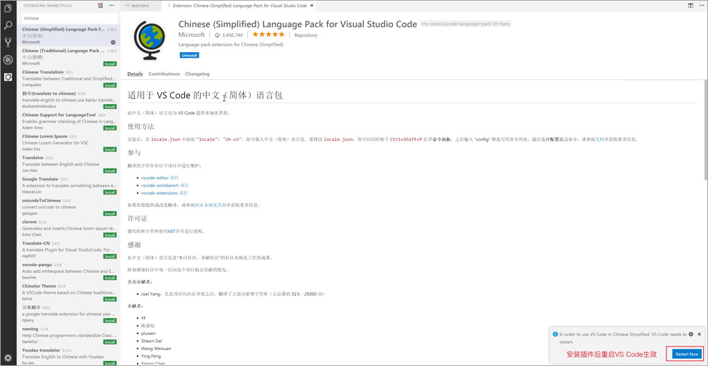
2.  open in browser插件安装 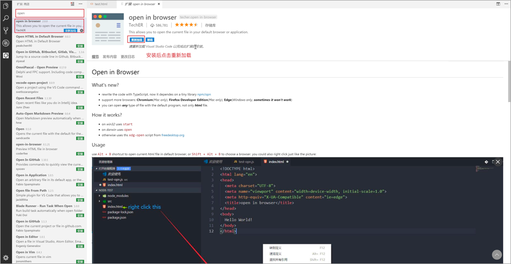 **注意: 如果在vscode打开的html文档中右击没有出现 open in browser 类型的选项，需要把当前打开的文件关掉，重新打开这个文件就好了。**

### 4\. vscode 的插件卸载

点击对应安装的插件，然后再点击卸载按钮即可。

### 5\. vscode 的使用

1.  打开文件夹创建文件 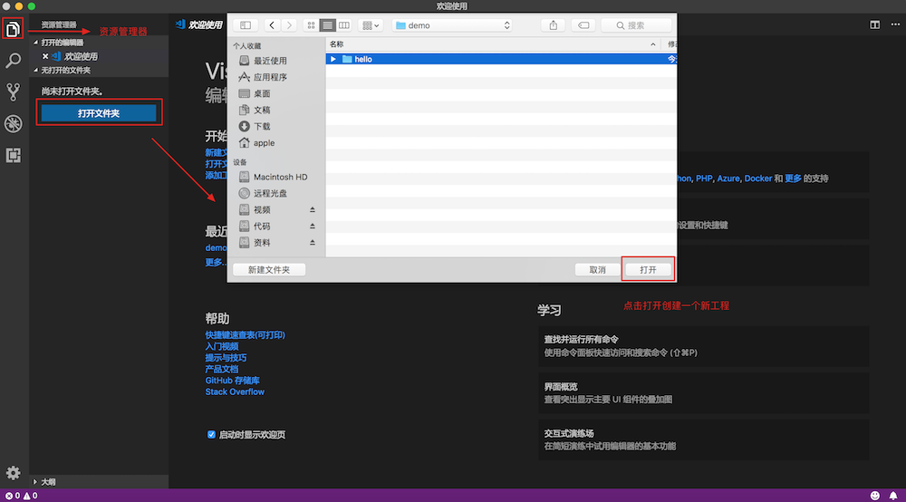 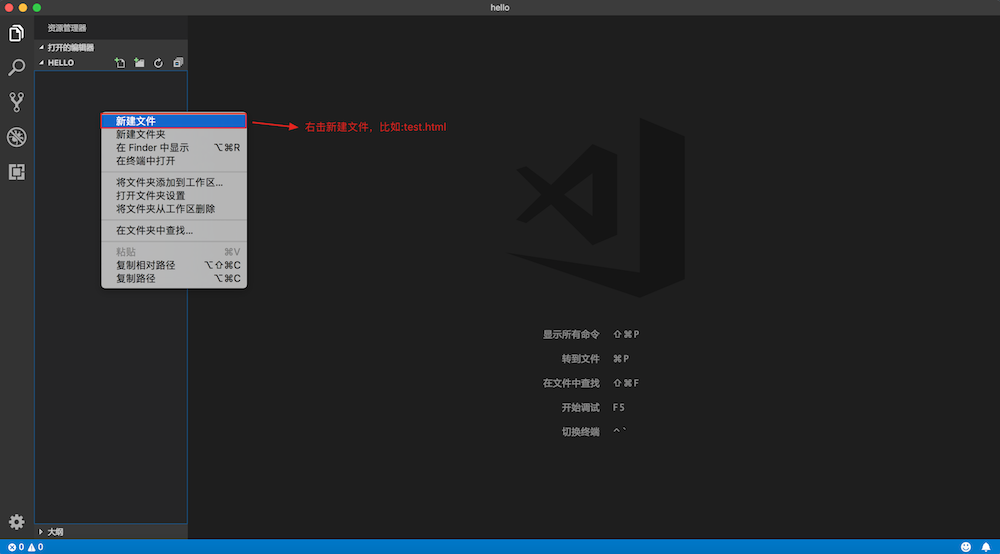
2.  快速创建html文档的基本结构 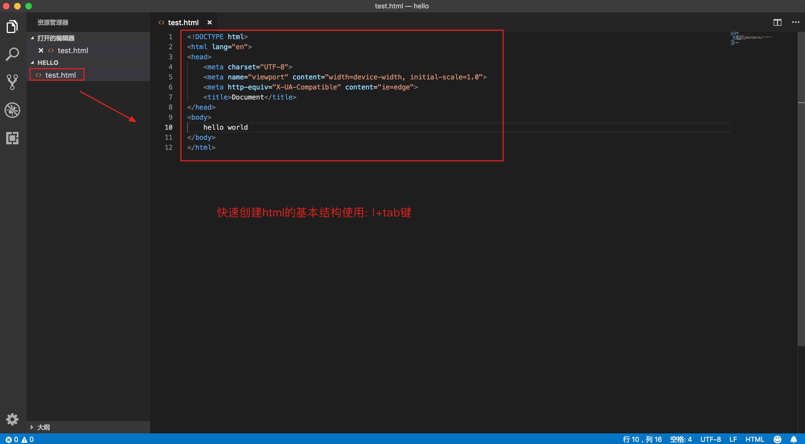
3.  右击在浏览器打开html文档 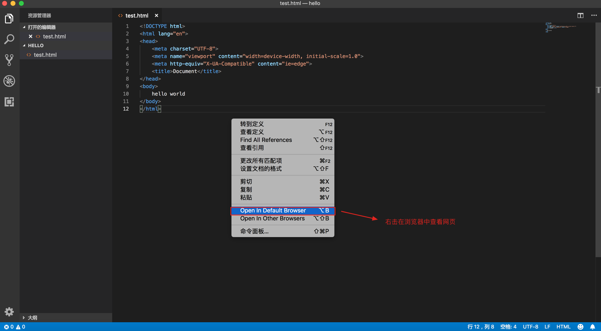

### 6\. 设置字体大小

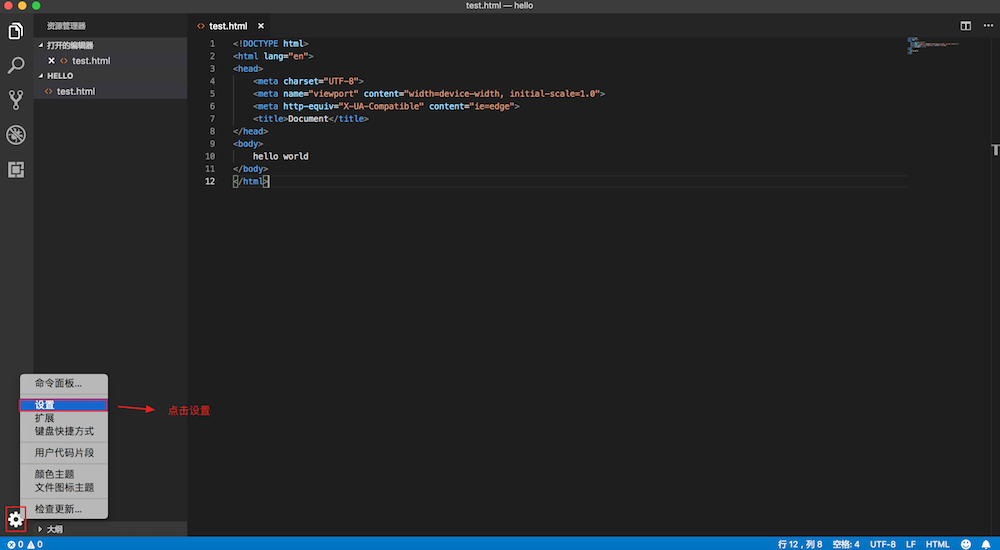  
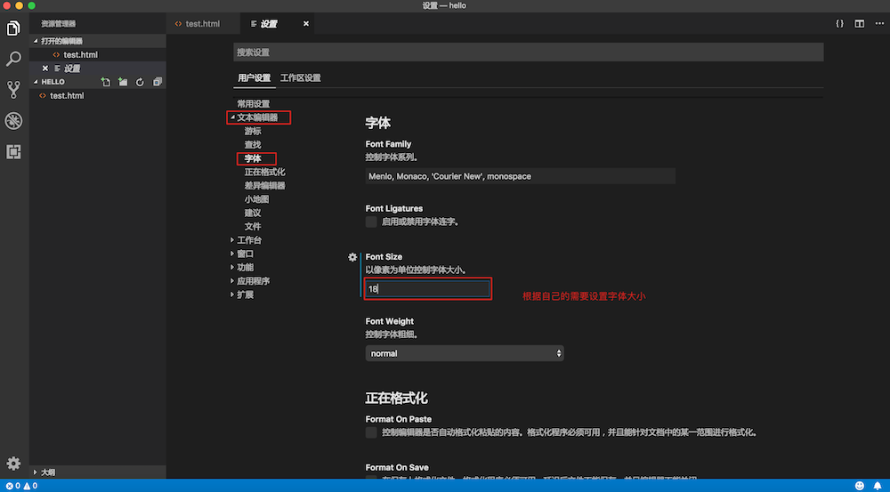

### 7\. 设置颜色主题

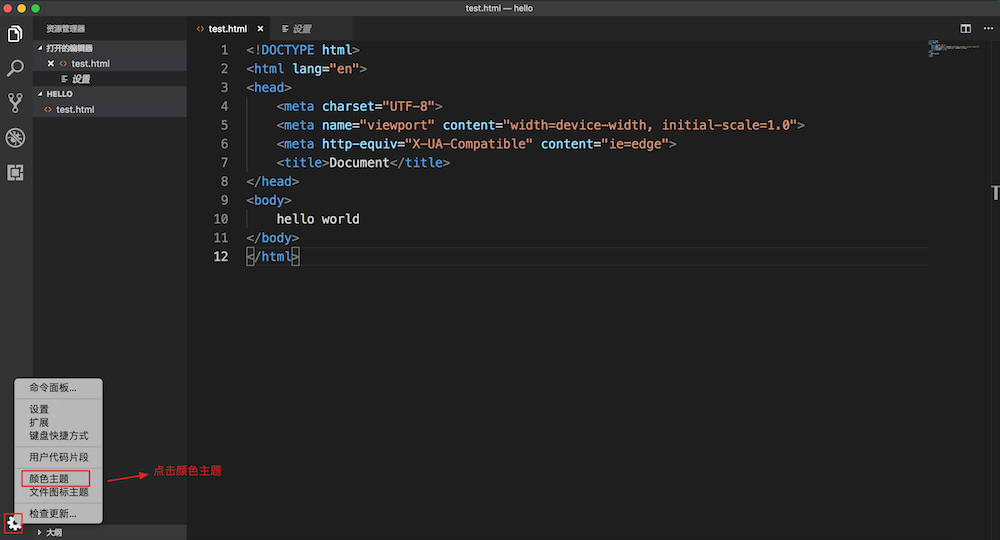  
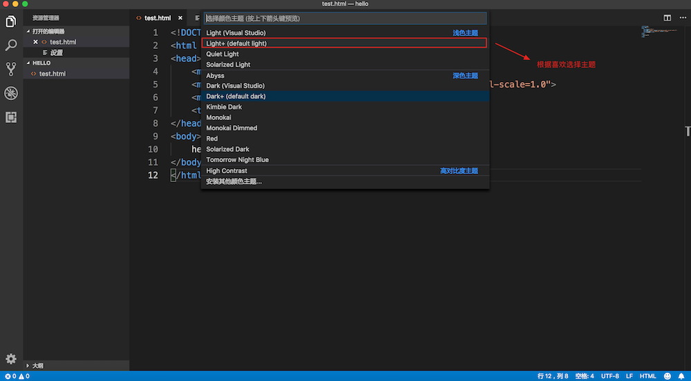

### 8\. 设置默认浏览器\[可选\]

1.  可以根据自己的需要设置默认使用的浏览器 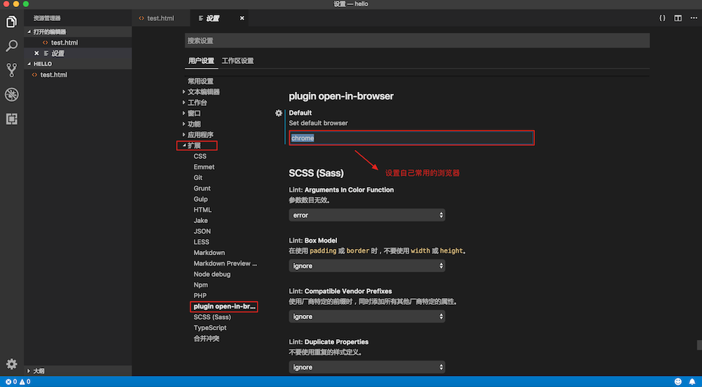

### 9\. 小结

-   vscode 是由微软研发的一款免费、开源的跨平台代码编辑器
-   通过资源管理器打开文件夹创建HTML文件，编写 HTML 代码
-   可以根据需要安装对应的插件
-   可以设置字体大小和颜色主题
