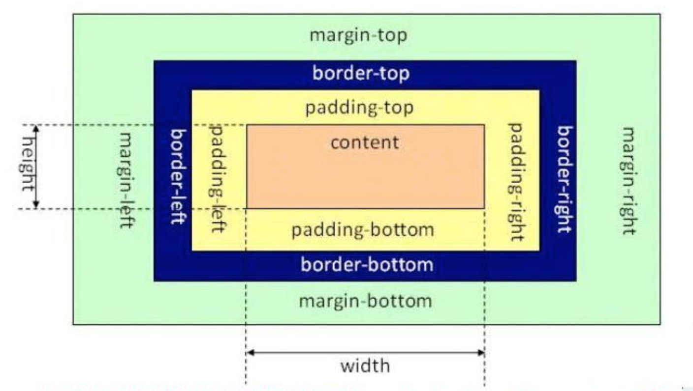

# 盒子模型

**学习目标**

-   能够知道盒子模型中的各个属性

* * *

### 1\. 盒子模型的介绍

所谓的盒子模型就是把HTML页面的元素看作一个矩形盒子，矩形盒子是由内容(content)、内边距(padding)、边框(border)、外边距(margin)四部分组成。

**盒子模型示意图如下：**



### 2\. 盒子模型相关样式属性

-   盒子的内容宽度(width)，注意：不是盒子的宽度
-   盒子的内容高度(height)，注意：不是盒子的高度
-   盒子的边框(border)
-   盒子内的内容和边框之间的间距(padding)
-   盒子与盒子之间的间距(margin)

**设置宽高：**

设置盒子的宽高，此宽高是指盒子内容的宽高，不是盒子整体宽高

```
width:200px;  /* 设置盒子的宽度，此宽度是指盒子内容的宽度，不是盒子整体宽度(难点) */ 
height:200px; /* 设置盒子的高度，此高度是指盒子内容的高度，不是盒子整体高度(难点) */
```

**设置边框:**

设置一边的边框，比如顶部边框，可以按如下设置：

```
border-top:10px solid red;
```

说明:

其中10px表示线框的粗细；solid表示线性；red表示边框的颜色

设置其它三个边的方法和上面一样，把上面的'top'换成'left'就是设置左边，换成'right'就是设置右边，换成'bottom'就是设置底边。

四个边如果设置一样，可以将四个边的设置合并成一句：

```
border:10px solid red;
```

**设置内间距padding**

设置盒子四边的内间距，可设置如下：

```
padding-top：20px;     /* 设置顶部内间距20px */ 
padding-left:30px;     /* 设置左边内间距30px */ 
padding-right:40px;    /* 设置右边内间距40px */ 
padding-bottom:50px;   /* 设置底部内间距50px */
```

上面的设置可以简写如下：

```
padding：20px 40px 50px 30px; /* 四个值按照顺时针方向，分别设置的是 上 右 下 左  
四个方向的内边距值。 */
```

padding后面还可以跟3个值，2个值和1个值，它们分别设置的项目如下：

```
padding：20px 40px 50px; /* 设置顶部内边距为20px，左右内边距为40px，底部内边距为50px */ 
padding：20px 40px; /* 设置上下内边距为20px，左右内边距为40px*/ 
padding：20px; /* 设置四边内边距为20px */
```

**设置外间距margin**

外边距的设置方法和padding的设置方法相同，将上面设置项中的'padding'换成'margin'就是外边距设置方法。

**盒子的真实尺寸**

盒子的width和height值固定时，如果盒子增加border和padding，盒子整体的尺寸会变大，所以盒子的真实尺寸为：

-   盒子宽度 = width + padding左右 + border左右
-   盒子高度 = height + padding上下 + border上下

### 小结

-   盒子模型的5个主要样式属性
    -   width：内容的宽度(不是盒子的宽度)
    -   height：内容的高度(不是盒子的高度)
    -   padding：内边距。
    -   border：边框。
    -   margin：外边距
-   盒子的真实尺寸只会受到宽度、高度、边框、内边距四个属性的影响，不会受到外边距属性的影响。
