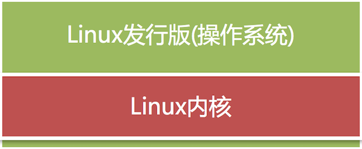

# Linux内核及发行版

**学习目标**

-   能够知道内核和发行版的关系
-   能够说出常用的Linux发行版操作系统

* * *

### 1\. Linux内核

Linux内核是操作系统内部**操作和控制硬件设备的核心程序**，它是由芬兰人**林纳斯**开发的。

**内核效果图:**

**说明:**

真正操作和控制硬件是由内核来完成的，操作系统是基于内核开发出来的。

### 2\. Linux发行版

是Linux内核与各种常用软件的组合产品，通俗来说就是我们常说的Linux操作系统。

**常用的Linux发行版:**

-   Ubuntu
-   CentOS
-   Redhat

**Linux发行版效果图:**

### 3\. 小结

-   Linux内核是Linux操作系统管理硬件设备的核心程序
-   常用的Linux操作系统都是基于Linux内核开发出来的
