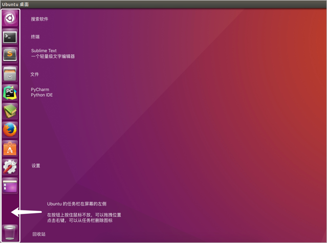
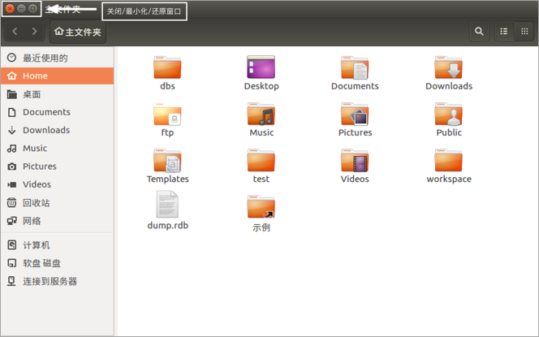
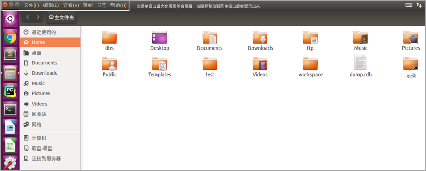
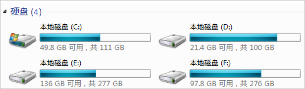
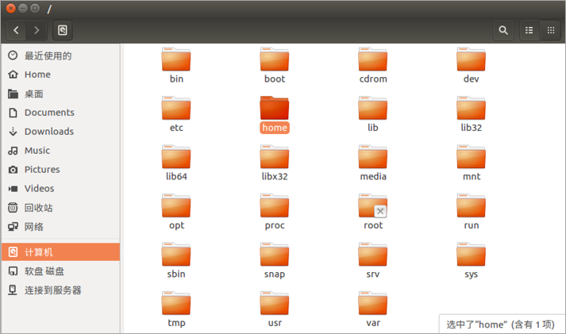
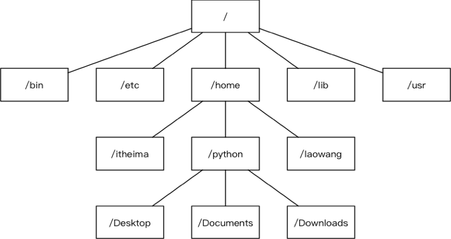
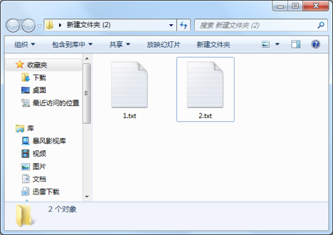
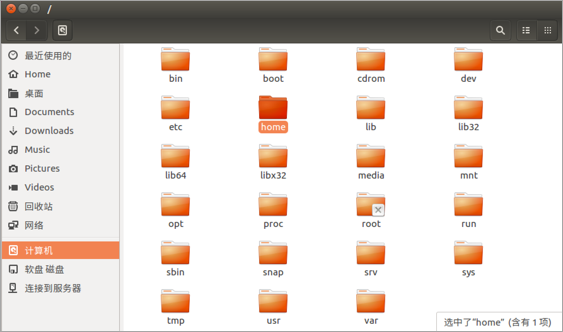

# Ubuntu操作系统

**学习目标**

-   能够说出Windows和Linux文件目录结构的区别

* * *

### 1\. Ubuntu操作系统的介绍

Ubuntu操作系统是属于**Linux操作系统中的一种**，它是免费、稳定又可以拥有绚丽界面的一个操作系统

### 2\. Ubuntu图形界面的介绍

-   任务栏
    
-   窗口操作按钮
    
-   窗口菜单条
    

**任务栏效果图:**

**窗口操作按钮效果图:**

**窗口菜单条效果图:**

### 3\. 与Windows目录结构对比

**Windows目录结构效果图:**

**说明:**

每一个盘符就是一个根目录，在Windows操作系统里面可能会出现多个根目录。

**Linux目录结构效果图:**

**说明:**

Ubuntu 没有盘符这个概念，只有一个根目录 / 。

**Linux主要目录介绍效果图:**

**主要目录说明:**

-   /：根目录
-   /bin：可执行二进制文件的目录
-   /etc：系统配置文件存放的目录
-   /home：用户家目录

### 4\. 与Windows窗口对比

**Windows窗口效果图:**

**Linux窗口效果图:**

**窗口对比说明:**

-   Windows窗口操作按钮在窗口左边
-   Linux窗口操作按钮在窗口右边

### 5\. 小结

-   Ubuntu操作系统属于Linux操作系统中的一种
-   Ubuntu操作系统窗口菜单条会隐藏，鼠标移动上去会显示，而Windows操作系统的窗口菜单条不会隐藏。
-   Windows操作系统有可能会有多个盘符（C、D、E、F）
-   Ubuntu操作系统没有多个盘符，只有一个根目录（/）
-   Ubuntu操作系统比Windows操作系统运行更加稳定。
