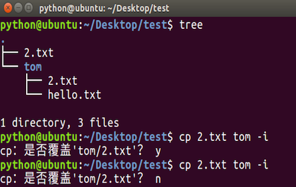
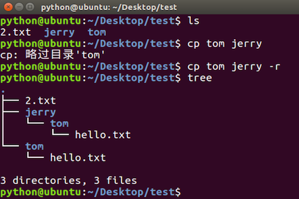
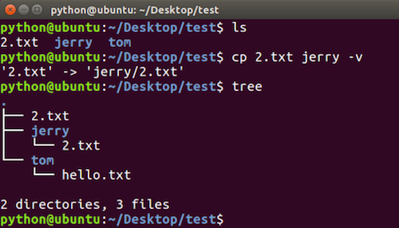
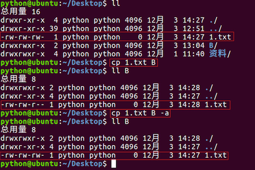
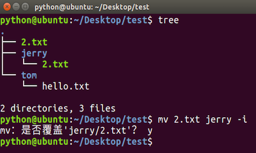
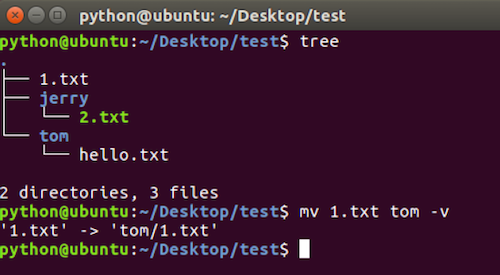

# cp和mv命令选项

**学习目标**

-   能够说出拷贝文件夹使用的命令选项

* * *

### 1\. cp命令选项

<html><head></head><body><table><thead><tr><th style="text-align:left">命令选项</th><th style="text-align:left">说明</th></tr></thead><tbody><tr><td style="text-align:left">-i</td><td style="text-align:left">交互式提示</td></tr><tr><td style="text-align:left">-r</td><td style="text-align:left">递归拷贝目录及其内容</td></tr><tr><td style="text-align:left">-v</td><td style="text-align:left">显示拷贝后的路径描述</td></tr><tr><td style="text-align:left">-a</td><td style="text-align:left">保留文件的原有权限</td></tr></tbody></table></body></html>

**cp -i命令选项效果图:**

**cp -r命令选项效果图:**

**cp -v命令选项效果图:**

**cp -a命令选项效果图:**

**\-a选项说明:**

-   \-a 选项还支持拷贝文件夹并且文件夹中的文件权限不丢失

### 2\. mv命令选项

<html><head></head><body><table><thead><tr><th style="text-align:left">命令选项</th><th style="text-align:left">说明</th></tr></thead><tbody><tr><td style="text-align:left">-i</td><td style="text-align:left">交互式提示</td></tr><tr><td style="text-align:left">-v</td><td style="text-align:left">显示移动后的路径描述</td></tr></tbody></table></body></html>

**mv -i命令选项效果图:**

**mv -v命令选项效果图:**

### 3\. 小结

-   拷贝文件防止覆盖使用 **“cp –i”** 操作
-   拷贝文件夹使用 **“cp –r”** 操作，拷贝文件夹并且文件权限不丢失使用 **“cp –a”** 操作。
-   移动文件防止覆盖使用 **“mv –i”** 操作
-   移动文件夹直接使用 **“mv”** 即可，**“mv”** 还可以给文件和文件夹重命名。
