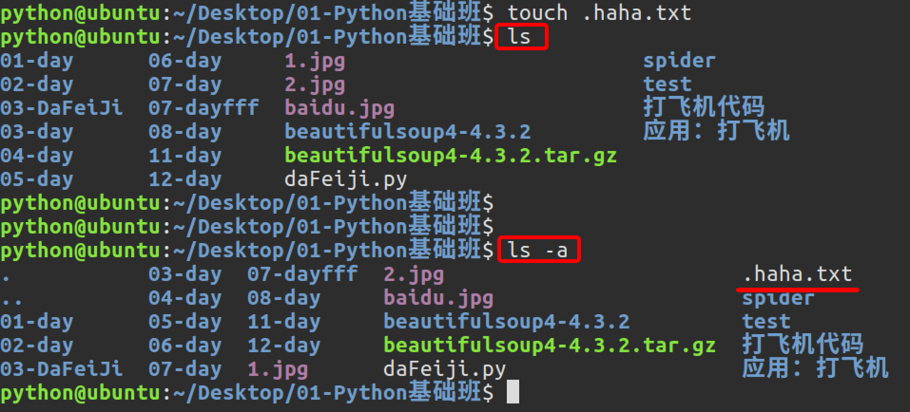
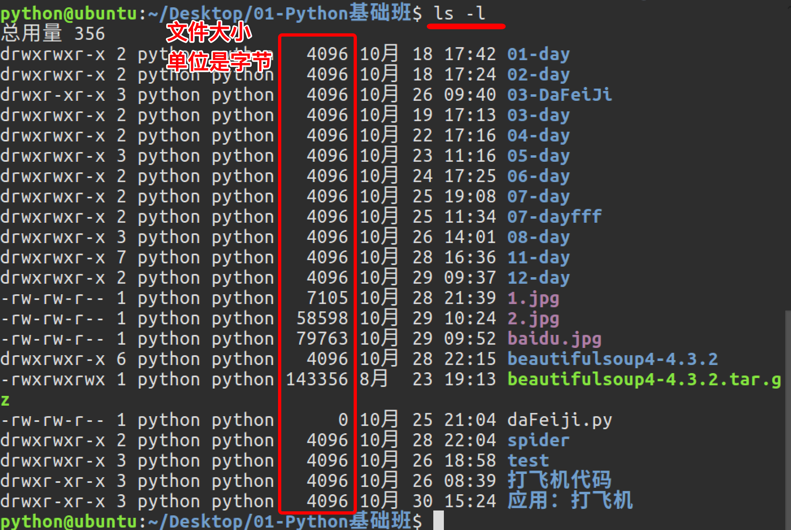
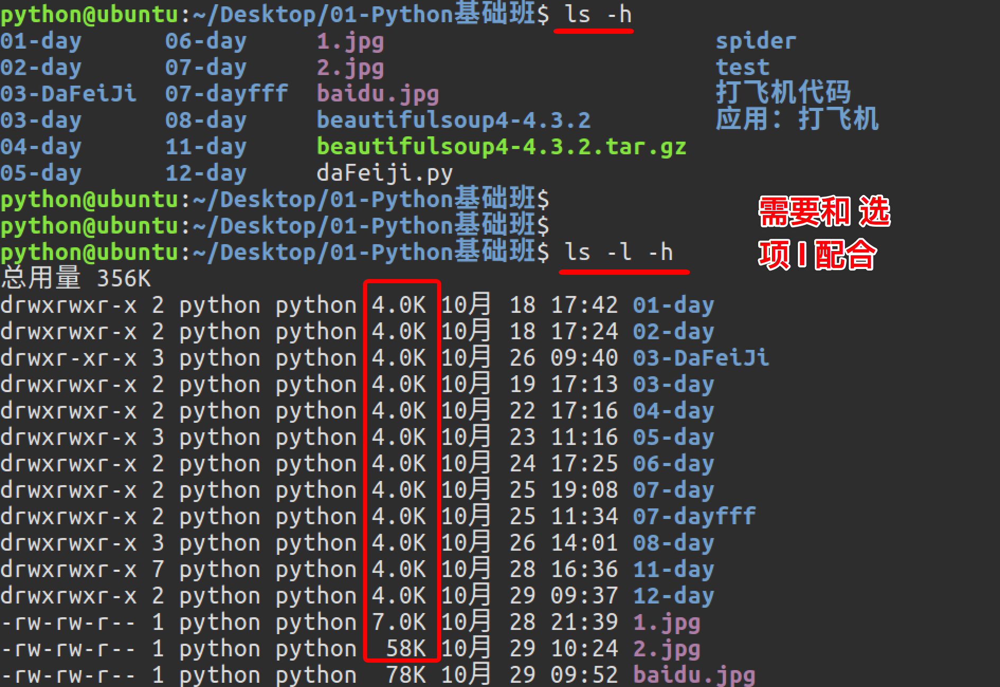
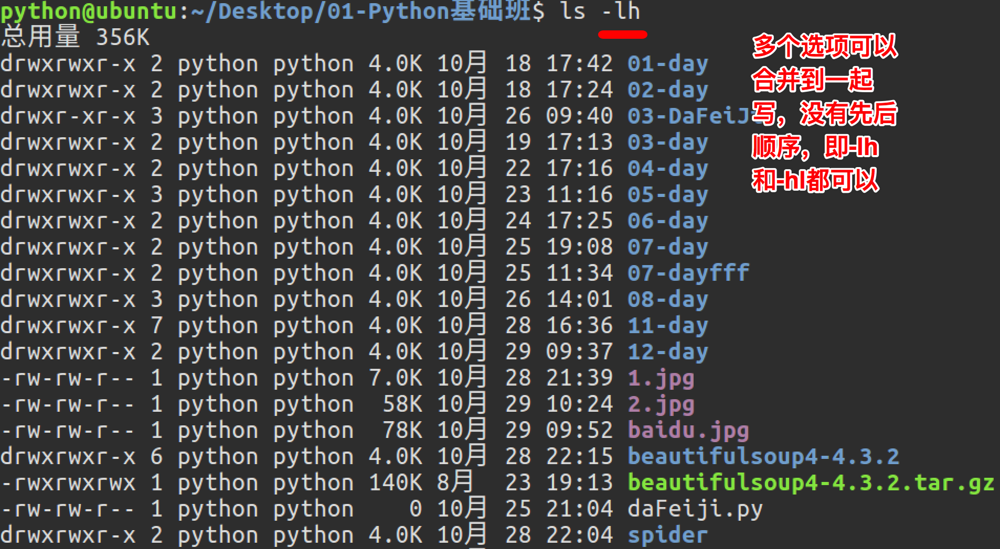
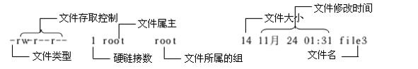

# ls命令选项

**学习目标**

-   能够说出查看目录中隐藏文件的命令选项

* * *

### 1\. ls命令选项使用

<html><head></head><body><table><thead><tr><th style="text-align:left">命令选项</th><th style="text-align:left">说明</th></tr></thead><tbody><tr><td style="text-align:left">-l</td><td style="text-align:left">以列表方式显示</td></tr><tr><td style="text-align:left">-h</td><td style="text-align:left">件大小单位显示，默认是字节</td></tr><tr><td style="text-align:left">-a</td><td style="text-align:left">显示隐藏文件和隐藏目录</td></tr></tbody></table></body></html>

**ls命令选项效果图:**

   

**每项信息说明:**

### 2\. 小结

-   ls不同选项会呈现不同的显示方式，其中-l和-a选项最常用
