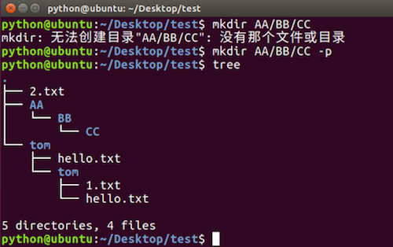
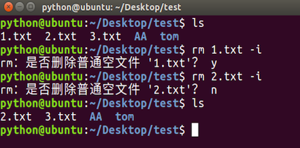
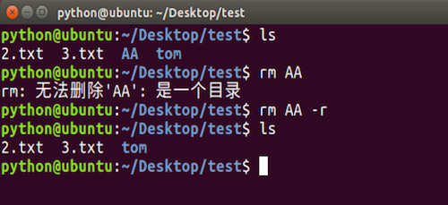
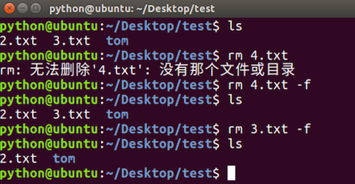
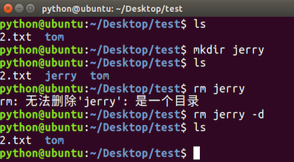

# mkdir和rm命令选项

**学习目标**

-   能够说出删除文件有提醒信息的命令选项

* * *

### 1\. mkdir命令选项

<html><head></head><body><table><thead><tr><th style="text-align:left">命令选项</th><th style="text-align:left">说明</th></tr></thead><tbody><tr><td style="text-align:left">-p</td><td style="text-align:left">创建所依赖的文件夹</td></tr></tbody></table></body></html>

**mkdir命令选项效果图:**

### 2\. rm命令选项

<html><head></head><body><table><thead><tr><th style="text-align:left">命令选项</th><th style="text-align:left">说明</th></tr></thead><tbody><tr><td style="text-align:left">-i</td><td style="text-align:left">交互式提示</td></tr><tr><td style="text-align:left">-r</td><td style="text-align:left">递归删除目录及其内容</td></tr><tr><td style="text-align:left">-f</td><td style="text-align:left">强制删除，忽略不存在的文件，无需提示</td></tr><tr><td style="text-align:left">-d</td><td style="text-align:left">删除空目录</td></tr></tbody></table></body></html>

**rm -i命令选项效果图:**

**rm -r命令选项效果图:**

**rm -f命令选项效果图:**

**rm -d命令选项效果图:**

### 3\. 小结

-   创建嵌套文件夹使用 **“mkdir –p”** 嵌套目录
-   删除空目录使用 **“rmdir 目录名”** 或者 **“rm –d 目录名”**
-   删除非空目录使用 **“rm –r 目录名”**
