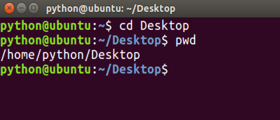
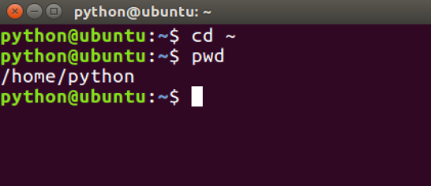
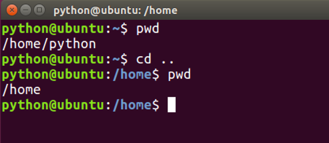
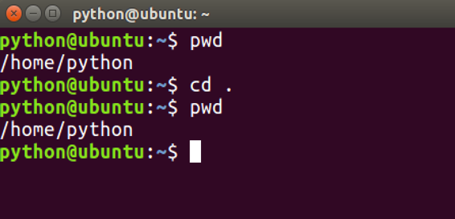

# 切换目录命令

**学习目标**

-   能够使用Linux命令查看目录信息

* * *

### 1\. 切换目录命令的使用

<html><head></head><body><table><thead><tr><th style="text-align:left">命令</th><th style="text-align:left">说明</th></tr></thead><tbody><tr><td style="text-align:left">cd 目录</td><td style="text-align:left">切换到指定目录</td></tr><tr><td style="text-align:left">cd ~</td><td style="text-align:left">切换到当前用户的主目录</td></tr><tr><td style="text-align:left">cd ..</td><td style="text-align:left">切换到上一级目录</td></tr><tr><td style="text-align:left">cd .</td><td style="text-align:left">切换到当前目录</td></tr><tr><td style="text-align:left">cd -</td><td style="text-align:left">切换到上一次目录</td></tr></tbody></table></body></html>

**注意:**

-   cd命令切换目录时，这个目录必须存在。
-   cd 后面不写目录等价于cd ~

**cd 目录效果图:**

**cd ~效果图:**

**cd ..效果图:**

**cd .效果图:**

**cd -效果图:**

### 2\. 小结

-   cd命令是完成目录切换操作的，当切换目录时，这个目录必须存在。
