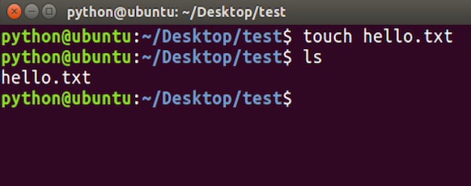
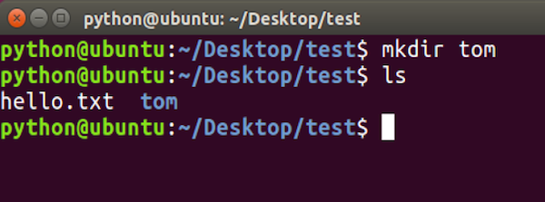
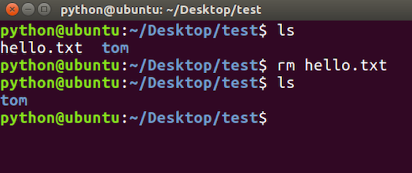
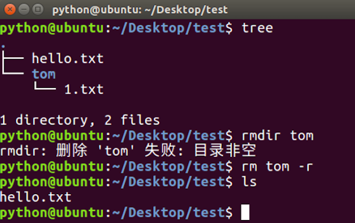
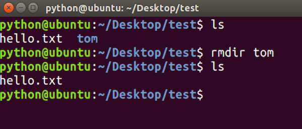

# 创建、删除文件及目录命令

**学习目标**

-   能够使用Linux命令创建文件夹

* * *

### 1\. 创建、删除文件及目录命令的使用

<html><head></head><body><table><thead><tr><th style="text-align:left">命令</th><th style="text-align:left">说明</th></tr></thead><tbody><tr><td style="text-align:left">touch 文件名</td><td style="text-align:left">创建指定文件</td></tr><tr><td style="text-align:left">mkdir 目录名</td><td style="text-align:left">创建目录(文件夹)</td></tr><tr><td style="text-align:left">rm 文件名或者目录名</td><td style="text-align:left">删除指定文件或者目录</td></tr><tr><td style="text-align:left">rmdir 目录名</td><td style="text-align:left">删除空目录</td></tr></tbody></table></body></html>

**touch命令效果图:**

**mkdir命令效果图:**

**rm命令效果图:**

**rm删除目录效果图**

**说明:**

**rm命令想要删除目录需要加上-r选项**，-r表示递归删除目录及其内容

**rmdir命令效果图:**

### 2\. 小结

-   touch 表示创建文件
-   mkdir 表示创建目录
-   rm 表示删除文件或者目录，如果删除目录需要使用 -r 选项，-r 表示递归删除目录及其内容
-   rmdir 表示删除空目录
