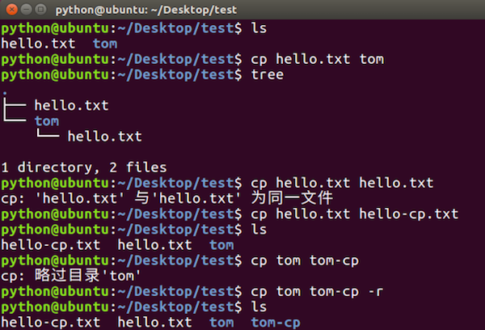
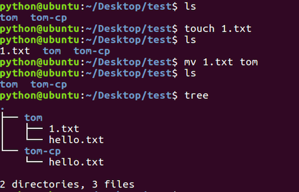
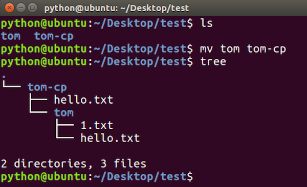
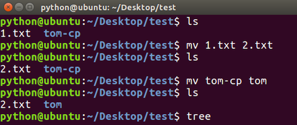

# 复制、移动文件及目录命令

**学习目标**

-   能够使用Linux命令拷贝和移动文件

* * *

### 1\. 复制、移动文件及目录命令的使用

<html><head></head><body><table><thead><tr><th style="text-align:left">命令</th><th style="text-align:left">说明</th></tr></thead><tbody><tr><td style="text-align:left">cp</td><td style="text-align:left">拷贝文件、拷贝目录</td></tr><tr><td style="text-align:left">mv</td><td style="text-align:left">移动文件、移动目录、重命名</td></tr></tbody></table></body></html>

**cp命令效果图:**

**说明:**

-   拷贝目录需要加上-r选项，-r表示递归拷贝目录及其内容

**mv命令移动文件效果图**

**mv命令移动目录效果图**

**mv命令重名名效果图**

### 2\. 小结

-   cp：拷贝目录需要加上 –r 选项
-   mv：移动目录不需要加选项
-   mv：命令还可以重命名文件和目录
