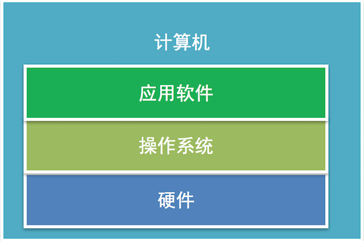
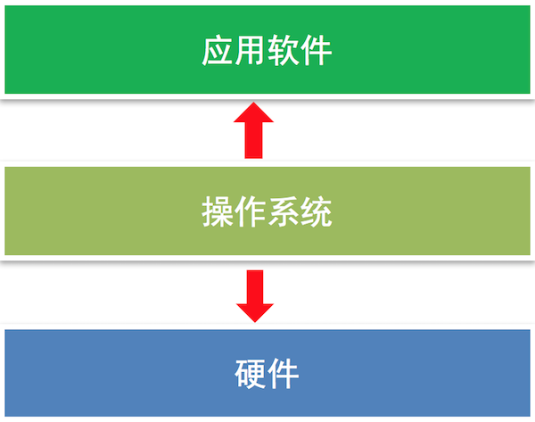

# 操作系统

**学习目标**

-   能够知道操作系统的作用

* * *

### 1\. 常见的操作系统

-   Windows
-   mac OS
-   Linux
-   iOS
-   Android

### 2\. 操作系统的定义

操作系统直接运行在计算机上的**系统软件**， 它是**控制硬件和支持软件运行的计算机程序**。

### 3\. 操作系统的作用

向下**控制硬件**向上**支持软件的运行**，具有承上启下的作用。

### 4\. 小结

操作系统是一个控制硬件和支持软件运行的计算机程序，只有安装了操作系统计算机才能进行正常工作。
