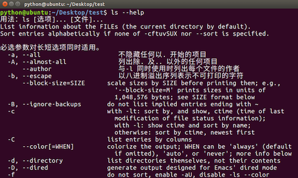
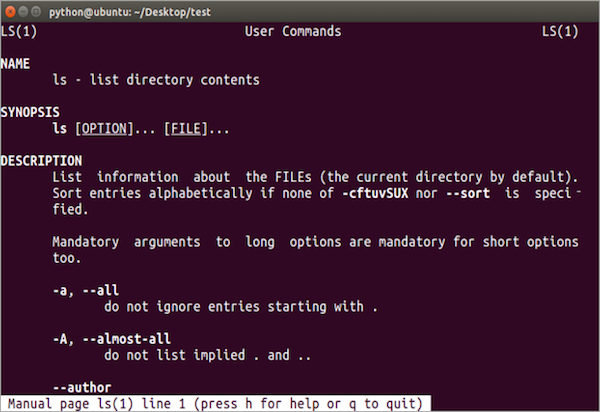

# 查看命令帮助

**学习目标**

-   能够知道查看命令帮助的方式

* * *

### 1\. 查看命令帮助方式

-   \--help 使用说明: 命令 --help
-   man 使用说明: man 命令

**查看命令帮助的目的说明:**

-   查看命令帮助目的是查看命令选项信息的

**\--help效果图:**

**man效果图:**

**man命令的说明:**

<html><head></head><body><table><thead><tr><th style="text-align:left">操作键</th><th style="text-align:left">说明</th></tr></thead><tbody><tr><td style="text-align:left">空格</td><td style="text-align:left">显示下一屏信息</td></tr><tr><td style="text-align:left">回车</td><td style="text-align:left">显示下一行信息</td></tr><tr><td style="text-align:left">b</td><td style="text-align:left">显示上一屏信息</td></tr><tr><td style="text-align:left">f</td><td style="text-align:left">显示下一屏信息</td></tr><tr><td style="text-align:left">q</td><td style="text-align:left">退出</td></tr></tbody></table></body></html>

### 2\. 小结

-   \--help和man是查看命令帮助的两种方式，主要是查看命令所对应的选项信息
