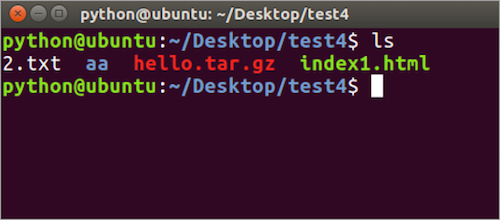
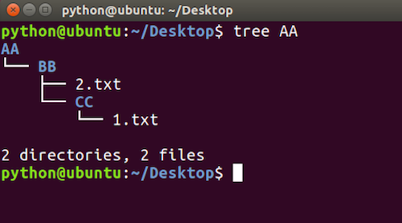
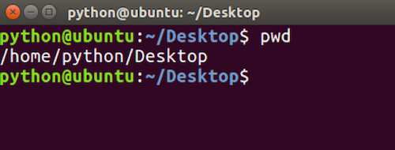
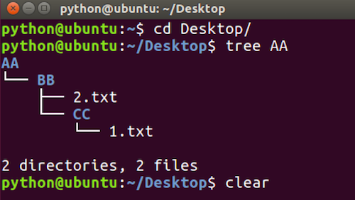
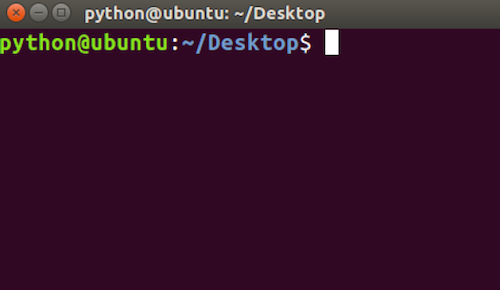

# 查看目录命令

**学习目标**

-   能够使用Linux命令查看目录信息

* * *

### 1\. 查看目录命令的使用

<html><head></head><body><table><thead><tr><th style="text-align:left">命令</th><th style="text-align:left">说明</th></tr></thead><tbody><tr><td style="text-align:left">ls</td><td style="text-align:left">查看当前目录信息</td></tr><tr><td style="text-align:left">tree</td><td style="text-align:left">以树状方式显示目录信息</td></tr></tbody></table></body></html>

**ls命令效果图:**

**tree命令效果图:**

### 2\. 查看当前目录路径

<html><head></head><body><table><thead><tr><th style="text-align:left">命令</th><th style="text-align:left">说明</th></tr></thead><tbody><tr><td style="text-align:left">pwd</td><td style="text-align:left">查看当前目录路径</td></tr></tbody></table></body></html>

**pwd命令效果图:**

### 3\. 清除终端内容

<html><head></head><body><table><thead><tr><th style="text-align:left">命令</th><th style="text-align:left">说明</th></tr></thead><tbody><tr><td style="text-align:left">clear</td><td style="text-align:left">清除终端内容</td></tr></tbody></table></body></html>

**pwd命令效果图:**

 

### 4\. 小结

-   ls和tree是我们查看目录信息最常用的命令
-   ls只能查看一层目录信息
-   tree可以查看多层目录信息。
