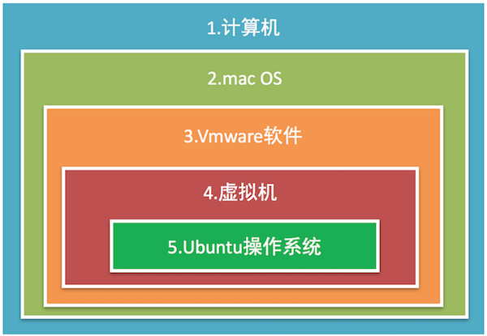
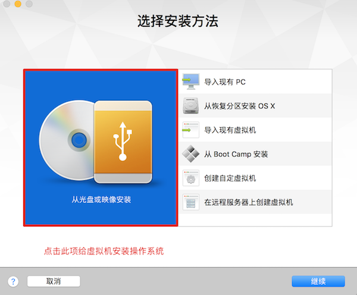
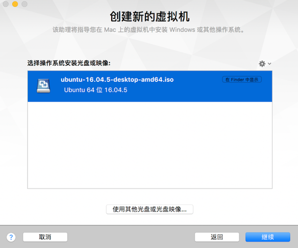
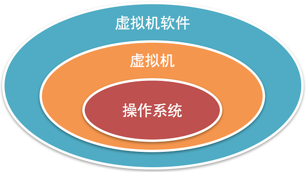

# 虚拟机软件

**学习目标**

-   能够说出虚拟机的作用

* * *

### 1\. 虚拟机软件的介绍

它是能够虚拟出来计算机的一个软件。

**常用虚拟机软件:**

-   Vmware
-   VirtualBox

**说明:**

只有安装了虚拟机软件才可以创建虚拟机，当然通过虚拟机软件还可以创建多个虚拟机。

### 2\. 虚拟机的介绍

就是模拟一个真实的计算机，好比一个虚拟的电脑，**对于快速学习一个新的操作系统就可以通过虚拟机来完成**。

**说明:**

虚拟机之间是相互独立的，删除虚拟机不会对其它虚拟机产生影响，当然也不会对电脑本身生影响

### 3\. 虚拟机软件的安装说明

-   Windows和Linux下载VMware Workstation版的安装包
-   mac OS下载VMware Fusion版的安装包
-   当对应的安装包下载完成以后双击进行安装就可以了
-   当虚拟机软件安装成功就可以创建虚拟机了

**创建虚拟机效果图**

这里需要提前下载一个操作系统镜像文件

然后安装提示一步步进行安装就可以了。

### 4\. 小结

-   对应快速学习一个新的操作系统，我们可以借助虚拟机来完成。
-   虚拟机软件、虚拟机、操作系统它们三者之间的关系：
    
    
