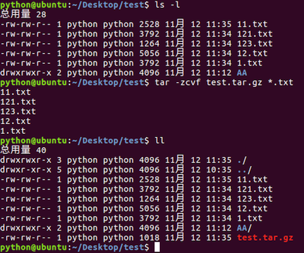
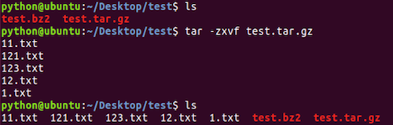
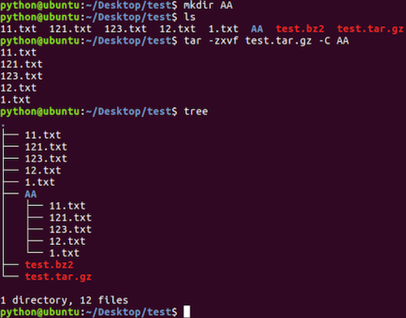
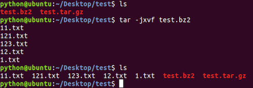
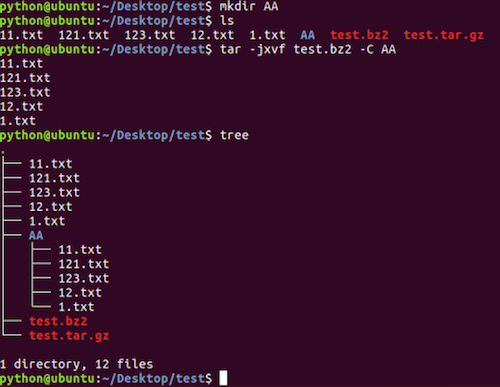
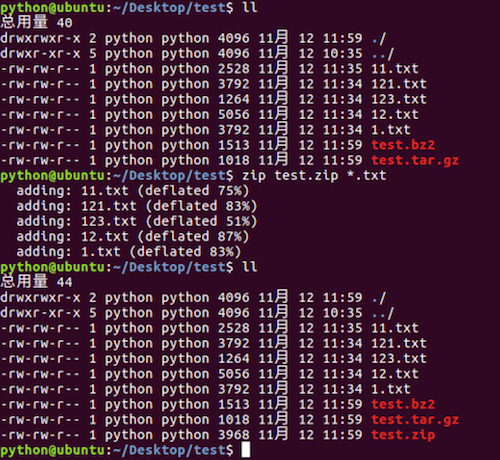
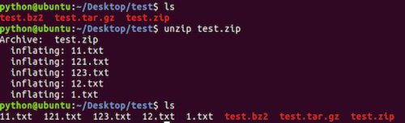
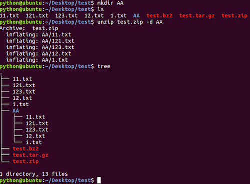

# 压缩和解压缩命令

**学习目标**

-   能够使用tar命令完成文件的压缩和解压缩

* * *

### 1\. 压缩格式的介绍

Linux默认支持的压缩格式:

-   .gz
-   .bz2
-   .zip

**说明:**

-   .gz和.bz2的压缩包需要使用tar命令来压缩和解压缩
-   .zip的压缩包需要使用zip命令来压缩，使用unzip命令来解压缩

**压缩目的:**

-   节省磁盘空间

### 2\. tar命令及选项的使用

<html><head></head><body><table><thead><tr><th style="text-align:left">命令</th><th style="text-align:left">说明</th></tr></thead><tbody><tr><td style="text-align:left">tar</td><td style="text-align:left">压缩和解压缩命令</td></tr></tbody></table></body></html>

**tar命令选项:**

<html><head></head><body><table><thead><tr><th style="text-align:left">选项</th><th style="text-align:left">说明</th></tr></thead><tbody><tr><td style="text-align:left">-c</td><td style="text-align:left">创建打包文件</td></tr><tr><td style="text-align:left">-v</td><td style="text-align:left">显示打包或者解包的详细信息</td></tr><tr><td style="text-align:left">-f</td><td style="text-align:left">指定文件名称, 必须放到所有选项后面</td></tr><tr><td style="text-align:left">-z</td><td style="text-align:left">压缩或解压缩(.gz)</td></tr><tr><td style="text-align:left">-j</td><td style="text-align:left">压缩或解压缩(.bz2)</td></tr><tr><td style="text-align:left">-x</td><td style="text-align:left">解包</td></tr><tr><td style="text-align:left">-C</td><td style="text-align:left">解压缩到指定目录</td></tr></tbody></table></body></html>

**压缩成.gz的效果图:**

**压缩成.bz2的效果图:**

**解压缩.gz的效果图:**

**解压缩.gz到指定目录效果图:**

**解压缩.bz2的效果图:**

**解压缩.bz2到指定目录效果图:**

### 3\. zip和unzip命令及选项的使用

<html><head></head><body><table><thead><tr><th style="text-align:left">命令</th><th style="text-align:left">说明</th></tr></thead><tbody><tr><td style="text-align:left">zip</td><td style="text-align:left">压缩成.zip格式文件</td></tr><tr><td style="text-align:left">unzip</td><td style="text-align:left">解压缩.zip格式文件</td></tr></tbody></table></body></html>

**unzip命令选项:**

<html><head></head><body><table><thead><tr><th style="text-align:left">选项</th><th style="text-align:left">说明</th></tr></thead><tbody><tr><td style="text-align:left">-d</td><td style="text-align:left">解压缩到指定目录</td></tr></tbody></table></body></html>

**压缩成.zip的效果图:**

**解压缩.gz的效果图:**

**解压缩.zip到指定目录效果图:**

**说明:**

-   压缩文件尽量使用.gz格式，因为占用空间较少
-   使用zip命令压缩的文件占用空间比较多, 当时比较通用，操作更加简单。

### 4\. 小结

-   .gz和.bz2的压缩文件使用tar命令来完成压缩和解压缩
-   .zip的压缩文件使用zip和unzip命令来完成压缩和解压缩
