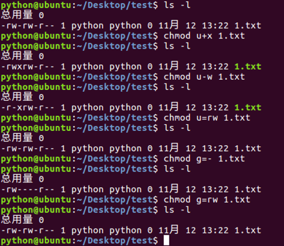
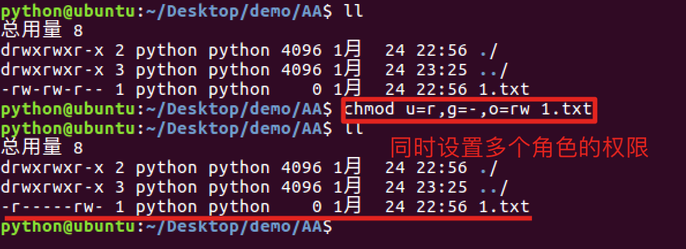
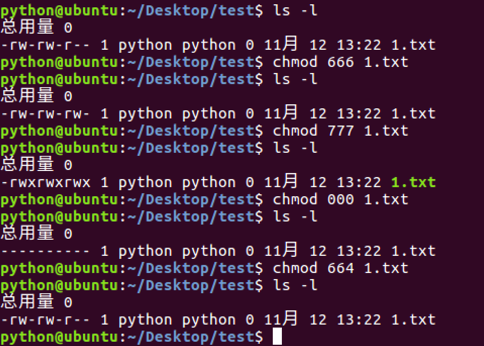

# 文件权限命令

**学习目标**

-   能够使用chmod命令完成文件权限的修改

* * *

### 1\. chmod命令的介绍

<html><head></head><body><table><thead><tr><th style="text-align:left">命令</th><th style="text-align:left">说明</th></tr></thead><tbody><tr><td style="text-align:left">chmod</td><td style="text-align:left">修改文件权限</td></tr></tbody></table></body></html>

chmod修改文件权限有两种方式:

-   字母法
-   数字法

### 2\. chmod 字母法的使用

**角色说明:**

<html><head></head><body><table><thead><tr><th style="text-align:left">角色</th><th style="text-align:left">说明</th></tr></thead><tbody><tr><td style="text-align:left">u</td><td style="text-align:left">user, 表示该文件的所有者</td></tr><tr><td style="text-align:left">g</td><td style="text-align:left">group, 表示用户组</td></tr><tr><td style="text-align:left">o</td><td style="text-align:left">other, 表示其他用户</td></tr><tr><td style="text-align:left">a</td><td style="text-align:left">all, 表示所有用户</td></tr></tbody></table></body></html>

**权限设置说明:**

<html><head></head><body><table><thead><tr><th style="text-align:left">操作符</th><th style="text-align:left">说明</th></tr></thead><tbody><tr><td style="text-align:left">+</td><td style="text-align:left">增加权限</td></tr><tr><td style="text-align:left">-</td><td style="text-align:left">撤销权限</td></tr><tr><td style="text-align:left">=</td><td style="text-align:left">设置权限</td></tr></tbody></table></body></html>

**权限说明:**

<html><head></head><body><table><thead><tr><th style="text-align:left">权限</th><th style="text-align:left">说明</th></tr></thead><tbody><tr><td style="text-align:left">r</td><td style="text-align:left">可读</td></tr><tr><td style="text-align:left">w</td><td style="text-align:left">可写</td></tr><tr><td style="text-align:left">x</td><td style="text-align:left">可执行</td></tr><tr><td style="text-align:left">-</td><td style="text-align:left">无任何权限</td></tr></tbody></table></body></html>

**chmod命令字母法效果图:**

**chmod命令同时设置多个角色的效果图:**

### 3\. chmod 数字法的使用

数字法就是“rwx” 这些权限也可以用**数字来代替**

**权限说明:**

<html><head></head><body><table><thead><tr><th style="text-align:left">权限</th><th style="text-align:left">说明</th></tr></thead><tbody><tr><td style="text-align:left">r</td><td style="text-align:left">可读，权限值是4</td></tr><tr><td style="text-align:left"></td></tr><tr><td style="text-align:left">w</td><td style="text-align:left">可写，权限值是2</td></tr><tr><td style="text-align:left">x</td><td style="text-align:left">可执行，权限值是1</td></tr><tr><td style="text-align:left">-</td><td style="text-align:left">无任何权限，权限值是0</td></tr></tbody></table></body></html>

**chmod命令数字法效果图:**

### 4\. 小结

-   利用 **chmod** 命令可以控制文件的操作权限。
-   字母法格式: chmod 不同角色设置的权限 文件
-   数字法格式: chmod 不同角色的权限值 文件名
