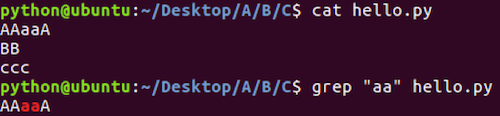
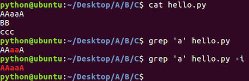
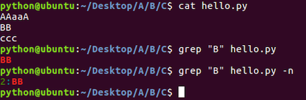
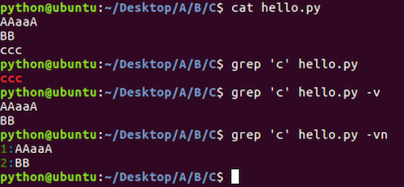
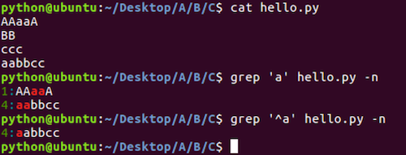
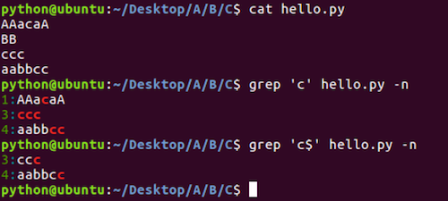
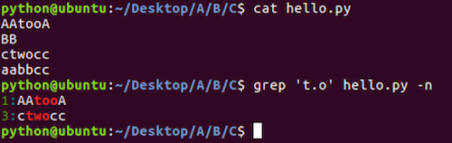

# 文本搜索命令

**学习目标**

-   能够知道文本搜索使用的命令

* * *

### 1\. grep命令的使用

<html><head></head><body><table><thead><tr><th style="text-align:left">命令</th><th style="text-align:left">说明</th></tr></thead><tbody><tr><td style="text-align:left">grep</td><td style="text-align:left">文本搜索</td></tr></tbody></table></body></html>

**grep命令效果图:**

### 2\. grep命令选项的使用

<html><head></head><body><table><thead><tr><th style="text-align:left">命令选项</th><th style="text-align:left">说明</th></tr></thead><tbody><tr><td style="text-align:left">-i</td><td style="text-align:left">忽略大小写</td></tr><tr><td style="text-align:left">-n</td><td style="text-align:left">显示匹配行号</td></tr><tr><td style="text-align:left">-v</td><td style="text-align:left">显示不包含匹配文本的所有行</td></tr></tbody></table></body></html>

**\-i命令选项效果图:**

**\-n命令选项效果图:**

**\-v命令选项效果图:**

### 3\. grep命令结合正则表达式的使用

<html><head></head><body><table><thead><tr><th style="text-align:left">正则表达式</th><th style="text-align:left">说明</th></tr></thead><tbody><tr><td style="text-align:left">^</td><td style="text-align:left">以指定字符串开头</td></tr><tr><td style="text-align:left">$</td><td style="text-align:left">以指定字符串结尾</td></tr><tr><td style="text-align:left">.</td><td style="text-align:left">匹配一个非换行符的字符</td></tr></tbody></table></body></html>

**正则表达式‘^’的效果图:**

**正则表达式‘$’的效果图:**

**正则表达式‘.’的效果图:**

### 4\. 扩展

-   **grep** 命令还可以文本搜索管道中的内容，比如: **ls / | grep ‘lib’**
-   在使用 **grep** 命令的时候还可以省略搜索内容的引号，比如: **ls / | grep lib**， **grep hello 1.txt**

### 5\. 小结

-   grep 命令是完成文本搜索操作的
-   文本搜索的命令格式: grep 选项 文本搜索内容
