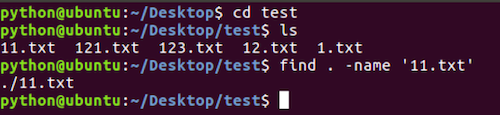
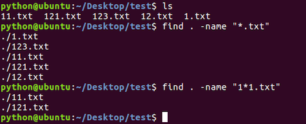
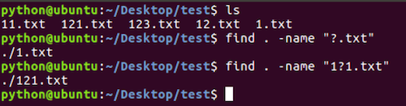
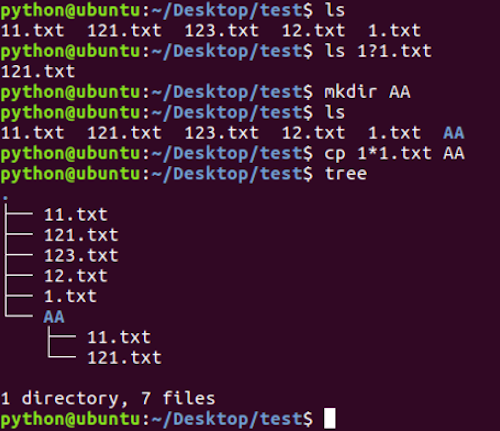

# 查找文件命令

**学习目标**

-   能够说出查找文件使用的命令

* * *

### 1\. find命令及选项的使用

<html><head></head><body><table><thead><tr><th style="text-align:left">命令</th><th style="text-align:left">说明</th></tr></thead><tbody><tr><td style="text-align:left">find</td><td style="text-align:left">在指定目录下查找文件(包括目录)</td></tr></tbody></table></body></html>

**find命令选项:**

<html><head></head><body><table><thead><tr><th style="text-align:left">选项</th><th style="text-align:left">说明</th></tr></thead><tbody><tr><td style="text-align:left">-name</td><td style="text-align:left">根据文件名(包括目录名)字查找</td></tr></tbody></table></body></html>

**find命令及选项的效果图:**

### 2\. find命令结合通配符的使用

**通配符:**

是一种特殊语句，主要有星号(\*)和问号(?)，用来模糊搜索文件

<html><head></head><body><table><thead><tr><th style="text-align:left">通配符</th><th style="text-align:left">说明</th></tr></thead><tbody><tr><td style="text-align:left">*</td><td style="text-align:left">代表0个或多个任意字符</td></tr><tr><td style="text-align:left"></td></tr><tr><td style="text-align:left">?</td><td style="text-align:left">代表任意一个字符</td></tr></tbody></table></body></html>

**\*通配符的效果图:**

**?通配符的效果图:**

**扩展:**

通配符不仅能结合 **find** 命令使用，还可以结合其它命令使用, 比如: **ls、mv、cp** 等，这里需要注意只有 **find** 命令使用通配符需要加上引号。

**扩展效果图:**

### 3\. 小结

-   find命令是完成查找文件操作的
-   查找文件的命令格式: find 指定查找目录 -name "文件名"
