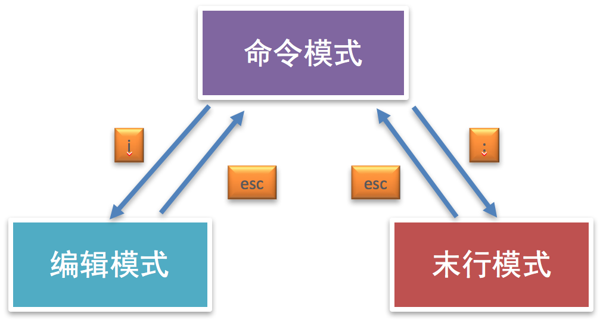

# 编辑器 vim

**学习目标**

-   能够说出vim的三种工作模式
-   能够说出vim对应复制和粘贴命令

* * *

### 1\. vim 的介绍

vim 是一款功能强大的文本编辑器，也是早年 Vi 编辑器的加强版，它的最大特色就是使用命令进行编辑，完全脱离了鼠标的操作。

### 2\. vim 的工作模式

-   命令模式
-   编辑模式
-   末行模式

**说明:**

vim 打开文件进入的是命令模式

**工作模式效果图:**

**注意点:**

编辑模式和末行模式之间不能直接进行切换，都需要通过命令模式来完成。

### 3\. vim 的末行模式命令

-   :w 保存
-   :wq 保存退出
-   :x 保存退出
-   :q! 强制退出

### 4\. vim 的常用命令

<html><head></head><body><table><thead><tr><th style="text-align:left">命令</th><th style="text-align:left">说明</th></tr></thead><tbody><tr><td style="text-align:left">yy</td><td style="text-align:left">复制光标所在行</td></tr><tr><td style="text-align:left">p</td><td style="text-align:left">粘贴</td></tr><tr><td style="text-align:left">dd</td><td style="text-align:left">删除/剪切当前行</td></tr><tr><td style="text-align:left">V</td><td style="text-align:left">按行选中</td></tr><tr><td style="text-align:left">u</td><td style="text-align:left">撤销</td></tr><tr><td style="text-align:left">ctr+r</td><td style="text-align:left">反撤销</td></tr><tr><td style="text-align:left">&gt;&gt;</td><td style="text-align:left">往右缩进</td></tr><tr><td style="text-align:left">&lt;&lt;</td><td style="text-align:left">往左缩进</td></tr><tr><td style="text-align:left">:/搜索的内容</td><td style="text-align:left">搜索指定内容</td></tr><tr><td style="text-align:left">:%s/要替换的内容/替换后的内容/g</td><td style="text-align:left">全局替换</td></tr><tr><td style="text-align:left">:开始行数,结束行数s/要替换的内容/替换后的内容</td><td style="text-align:left">局部替换</td></tr><tr><td style="text-align:left">.</td><td style="text-align:left">重复上一次命令操作</td></tr><tr><td style="text-align:left">G</td><td style="text-align:left">回到最后一行</td></tr><tr><td style="text-align:left">gg</td><td style="text-align:left">回到第一行</td></tr><tr><td style="text-align:left">数字+G</td><td style="text-align:left">回到指定行</td></tr><tr><td style="text-align:left">shift+6</td><td style="text-align:left">回到当前行的行首</td></tr><tr><td style="text-align:left">shift+4</td><td style="text-align:left">回到当前行的行末</td></tr><tr><td style="text-align:left">ctr+f</td><td style="text-align:left">下一屏</td></tr><tr><td style="text-align:left">ctr+b</td><td style="text-align:left">上一屏</td></tr></tbody></table></body></html>

### 5\. 小结

vim 是一款功能强大的命令文本编辑器，可以对远程服务器的代码直接进行修改，这样操作起来更加快速和方便。
