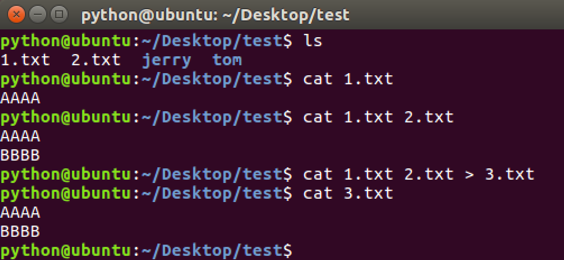
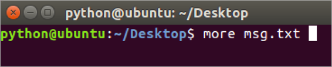
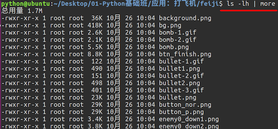

# 查看文件内容命令

**学习目标**

-   能够说出查看大文件分屏显示使用的命令

* * *

### 1\. 查看文件内容命令的使用

<html><head></head><body><table><thead><tr><th style="text-align:left">命令</th><th style="text-align:left">说明</th></tr></thead><tbody><tr><td style="text-align:left">cat</td><td style="text-align:left">查看小型文件</td></tr><tr><td style="text-align:left">more</td><td style="text-align:left">分屏查看大型文件</td></tr></tbody></table></body></html>

**cat命令的效果图**

**说明:**

-   cat命令结合重定向可以完成多个文件的合并
-   gedit 文件编辑命令，可以查看和编辑文件

**more命令的效果图**

当查看内容信息过长无法在一屏上显示时，可以使用 more 命令在终端分配显示文件内容。

**操作键说明:**

<html><head></head><body><table><thead><tr><th style="text-align:left">操作键</th><th style="text-align:left">说明</th></tr></thead><tbody><tr><td style="text-align:left">空格</td><td style="text-align:left">显示下一屏信息</td></tr><tr><td style="text-align:left">回车</td><td style="text-align:left">显示下一行信息</td></tr><tr><td style="text-align:left">b</td><td style="text-align:left">显示上一屏信息</td></tr><tr><td style="text-align:left">f</td><td style="text-align:left">显示下一屏信息</td></tr><tr><td style="text-align:left">q</td><td style="text-align:left">退出</td></tr></tbody></table></body></html>

### 2\. 管道(|)命令的使用

管道(|)：一个命令的输出可以通过管道做为另一个命令的输入，可以理解成是一个容器，存放在终端显示的内容。

**管道命令的效果图:**

**说明:**

管道(|)一般结合 more 命令使用，主要是分配查看终端显示内容。

### 3\. 小结

-   查看小文件使用 **cat** 命令
-   分屏查看大型文件使用 **more** 命令，
-   查看终端显示内容并分屏展示，使用 **管道(|)** 结合 **more** 命令。
