# 用户相关操作

**学习目标**

-   能够知道创建用户的命令

* * *

### 1\. 创建用户

<html><head></head><body><table><thead><tr><th style="text-align:left">命令</th><th style="text-align:left">说明</th></tr></thead><tbody><tr><td style="text-align:left">useradd</td><td style="text-align:left">创建(添加)用户</td></tr></tbody></table></body></html>

**useradd命令选项:**

<html><head></head><body><table><thead><tr><th style="text-align:left">选项</th><th style="text-align:left">说明</th></tr></thead><tbody><tr><td style="text-align:left">-m</td><td style="text-align:left">自动创建用户主目录,主目录的名字就是用户名</td></tr><tr><td style="text-align:left">-g</td><td style="text-align:left">指定用户所属的用户组，默认不指定会自动创建一个同名的用户组</td></tr></tbody></table></body></html>

**创建用户效果图:**

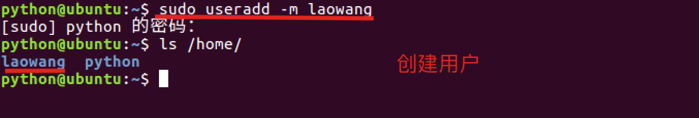

**查看所有用户信息的文件效果图:**

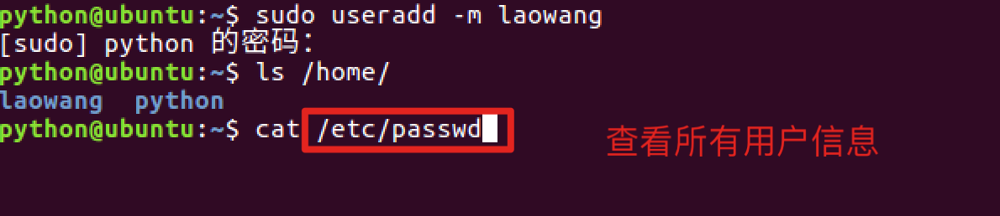 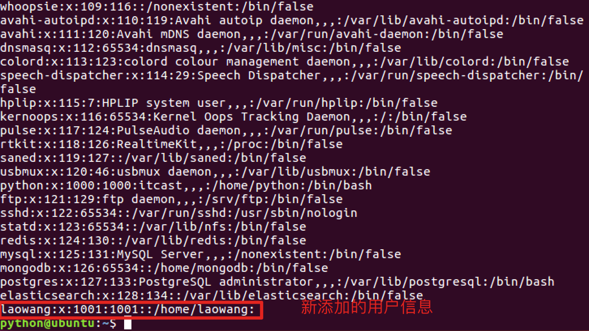

**说明:**

-   **useradd** 命令的使用需要使用管理员权限，前面需要加上 **sudo**
-   创建用户如果不指定用户组，默认会自动创建一个同名的用户组
-   查看用户是否创建成功，可以查看**/etc/passwd**这个文件
-   查看用户组是否创建成功，可以查看**/etc/group**这个文件

**passwd文件中的每项信息说明,以root:x:0:0:root:/root:/bin/bash为例:**

-   第一个：用户名
-   第二个：密码占位符
-   第三个：uid, 用户id
-   第四个：gid, 用户所在组id
-   第五个：用户描述, 可选，
-   第六个：用户的主目录所在位置
-   第七个：用户所用 shell 的类型，一般由bash或者sh，默认不设置是sh类型

**group文件中的每项信息说明, 以laowang:x:1001:为例:**

-   第一个：用户组名
-   第二个：用户组密码占位符，一般Linux系统的用户组都没有密码的
-   第三个：组id

**id命令查看用户信息:**

<html><head></head><body><table><thead><tr><th style="text-align:left">命令</th><th style="text-align:left">说明</th></tr></thead><tbody><tr><td style="text-align:left">id</td><td style="text-align:left">查看用户信息</td></tr></tbody></table></body></html>

**id命令效果图:** 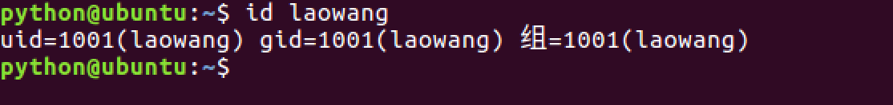

**每项信息说明:**

uid=1001(laowang) gid=1001(laowang) 组=1001(laowang)

-   第一个: uid 表示用户id
-   第二个: gid 表示用户组id
-   第三个: 组 表示用户所在的用户组

### 2\. 设置密码

给其它用户设置密码，需要使用: **sudo passwd 用户名**

**设置密码效果图:** 

### 3\. 切换用户

<html><head></head><body><table><thead><tr><th style="text-align:left">命令</th><th style="text-align:left">说明</th></tr></thead><tbody><tr><td style="text-align:left">su</td><td style="text-align:left">切换用户</td></tr></tbody></table></body></html>

**语法格式: su - 用户名**

**切换用户效果图:**

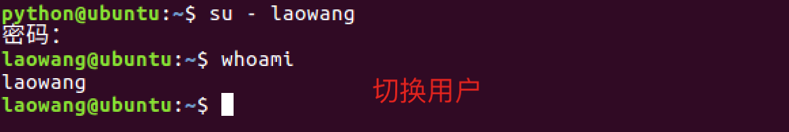

**在laowang用户使用sudo -s效果图:**

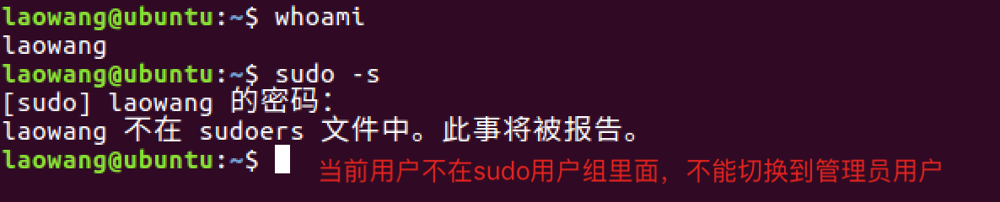

解决办法:

-   给laowang用户设置一个sudo附加组， 需要使用usermod修改用户信息

### 4\. 修改用户信息

<html><head></head><body><table><thead><tr><th style="text-align:left">命令</th><th style="text-align:left">说明</th></tr></thead><tbody><tr><td style="text-align:left">usermod</td><td style="text-align:left">修改用户信息</td></tr></tbody></table></body></html>

**usermod选项:**

<html><head></head><body><table><thead><tr><th style="text-align:left">命令</th><th style="text-align:left">说明</th></tr></thead><tbody><tr><td style="text-align:left">-G</td><td style="text-align:left">设置一个附加组</td></tr><tr><td style="text-align:left">-g</td><td style="text-align:left">修改用户组</td></tr></tbody></table></body></html>

**usermod命令效果图:**

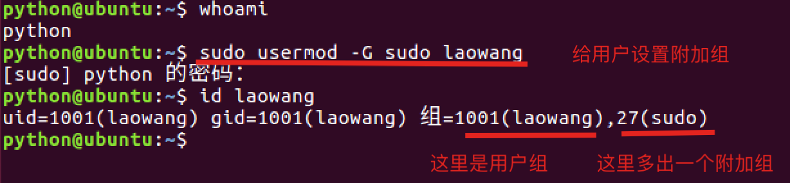

**设置附加组sudo以后，在sudo -s切换到管理员用户效果图:**

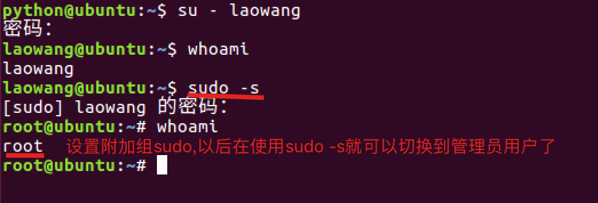

### 5\. 扩展: 删除附加组

<html><head></head><body><table><thead><tr><th style="text-align:left">命令</th><th style="text-align:left">说明</th></tr></thead><tbody><tr><td style="text-align:left">gpasswd</td><td style="text-align:left">添加和删除附加组信息</td></tr></tbody></table></body></html>

**gpasswd命令选项:**

<html><head></head><body><table><thead><tr><th style="text-align:left">选项</th><th style="text-align:left">说明</th></tr></thead><tbody><tr><td style="text-align:left">-a 用户名</td><td style="text-align:left">给用户添加附加组</td></tr><tr><td style="text-align:left">-d 用户名</td><td style="text-align:left">给用户删除附加组</td></tr></tbody></table></body></html>

**删除附加组效果图:**

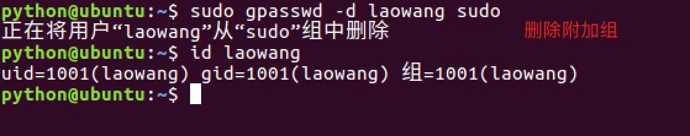

**删除附加组再次使用 sudo -s 效果图:**

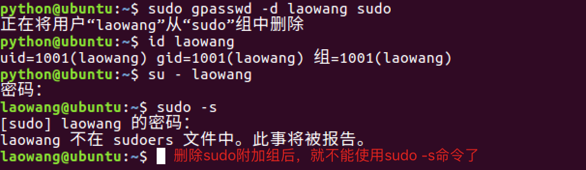

### 5\. 删除用户

<html><head></head><body><table><thead><tr><th style="text-align:left">命令</th><th style="text-align:left">说明</th></tr></thead><tbody><tr><td style="text-align:left">userdel</td><td style="text-align:left">删除用户</td></tr></tbody></table></body></html>

**userdel命令选项:**

<html><head></head><body><table><thead><tr><th style="text-align:left">选项</th><th style="text-align:left">说明</th></tr></thead><tbody><tr><td style="text-align:left">-r 用户名</td><td style="text-align:left">删除用户主目录，必须要设置，否则用户主目录不会删除</td></tr></tbody></table></body></html>

**删除用户效果图:**

**id查看用户信息效果图:**

**查看group文件信息效果图:**

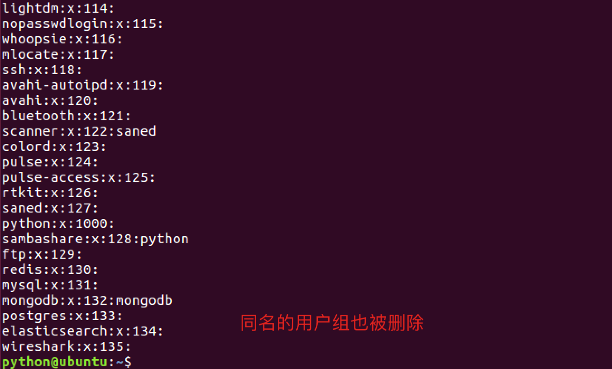

**说明:**

-   删除用户，默认同名的用户组也会被删除

### 6\. 小结

-   创建用户命令格式: **sudo useradd -m 用户名**, 默认会创建一个同名的用户组。
-   查看用户信息使用 **id** 命令或者 **/etc/passwd文件**
-   查看用户组信息使用 **/etc/group文件**
-   给用户设置密码使用 **sudo passwd 用户名**
-   切换用户使用 **su - 用户名**
-   设置附加组使用 **sudo usermod -G** 组名 用户名
-   删除用户使用 **sudo userdel -r 用户名**，默认会删除同名的用户组。
