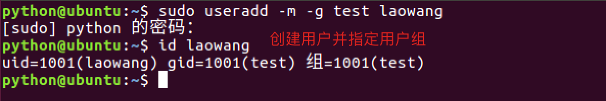
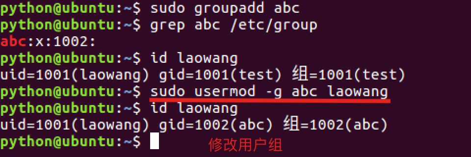
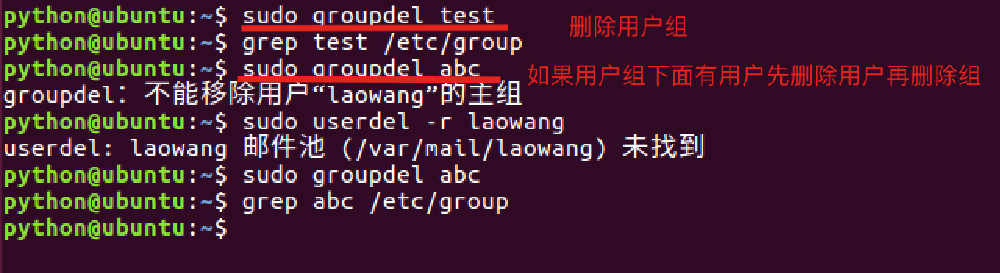

# 用户组相关操作

**学习目标**

-   能够知道创建用户组的命令

* * *

### 1\. 创建用户组

<html><head></head><body><table><thead><tr><th style="text-align:left">命令</th><th style="text-align:left">说明</th></tr></thead><tbody><tr><td style="text-align:left">groupadd</td><td style="text-align:left">创建(添加)用户组</td></tr></tbody></table></body></html>

**创建用户组效果图:**

### 2\. 创建用户并指定用户组

**创建用户并指定用户组效果图:**

### 3\. 修改用户组

**修改用户组效果图:**

### 4\. 删除用户组

<html><head></head><body><table><thead><tr><th style="text-align:left">命令</th><th style="text-align:left">说明</th></tr></thead><tbody><tr><td style="text-align:left">groupdel</td><td style="text-align:left">删除用户组</td></tr></tbody></table></body></html>

**删除用户组效果图:**

**说明:**

-   如果用户组下面有用户先删除用户在删除用户组

### 5\. 小结

-   创建用户组使用: **sudo groupadd 用户组名**
-   创建用户并指定用户组使用: **sudo useradd -m -g 用户组 用户名**
-   修改用户组使用: **sudo usermod -g 用户组 用户名**
-   删除用户组使用: **sudo groupdel 用户组名**
