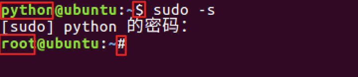
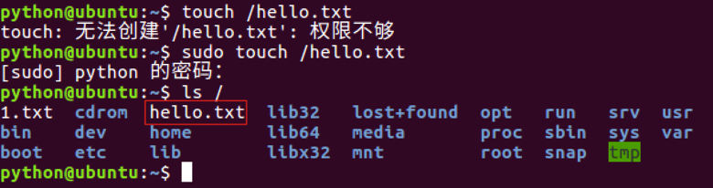
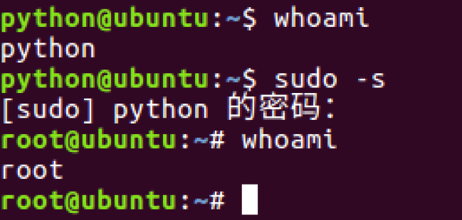
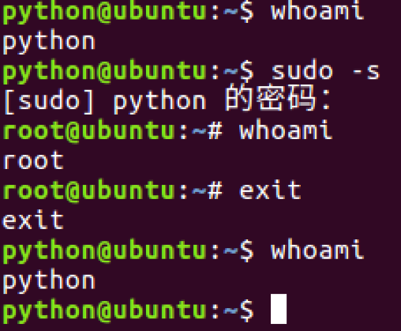
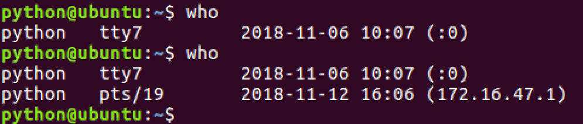
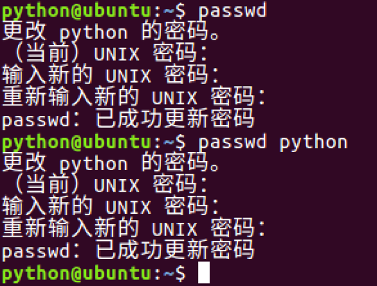
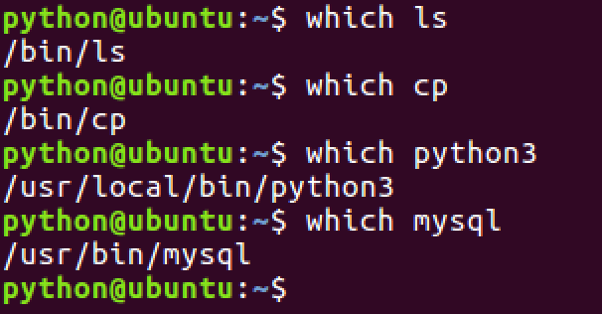

# 获取管理员权限的相关命令

**学习目标**

-   能够知道切换到管理员用户的命令

* * *

### 1\. sudo命令的使用

<html><head></head><body><table><thead><tr><th style="text-align:left">命令</th><th style="text-align:left">说明</th></tr></thead><tbody><tr><td style="text-align:left">sudo -s</td><td style="text-align:left">切换到root用户，获取管理员权限</td></tr><tr><td style="text-align:left">sudo</td><td style="text-align:left">某个命令的执行需要获取管理员权限可以在执行命令前面加上sudo</td></tr></tbody></table></body></html>

**sudo -s效果图:**

**sudo 命令效果图:**

**说明:**

-   如果只是某次操作需要使用管理员权限建议使用 sudo , 也就是说临时使用管理器权限。
-   如果大量操作都需要使用管理员权限 sudo –s, 但是操作需谨慎。

### 2\. whoami命令的使用

<html><head></head><body><table><thead><tr><th style="text-align:left">命令</th><th style="text-align:left">说明</th></tr></thead><tbody><tr><td style="text-align:left">whoami</td><td style="text-align:left">查看当前用户限</td></tr></tbody></table></body></html>

**whoami 命令效果图:**

### 3\. exit命令的使用

<html><head></head><body><table><thead><tr><th style="text-align:left">命令</th><th style="text-align:left">说明</th></tr></thead><tbody><tr><td style="text-align:left">exit</td><td style="text-align:left">退出登录用户</td></tr></tbody></table></body></html>

**exit 命令的效果图:**

**说明:**

-   如果是切换后的登陆用户，退出则返回上一个登陆账号。
-   如果是终端界面，退出当前终端。

### 4\. who命令的使用

<html><head></head><body><table><thead><tr><th style="text-align:left">命令</th><th style="text-align:left">说明</th></tr></thead><tbody><tr><td style="text-align:left">who</td><td style="text-align:left">查看所有的登录用户</td></tr></tbody></table></body></html>

**who 命令的效果图:**

### 5\. passwd命令的使用

<html><head></head><body><table><thead><tr><th style="text-align:left">命令</th><th style="text-align:left">说明</th></tr></thead><tbody><tr><td style="text-align:left">passwd</td><td style="text-align:left">修改用户密码，不指定用户默认修改当前登录用户密码</td></tr></tbody></table></body></html>

**passwd 命令的效果图:**

### 6\. which命令的使用

<html><head></head><body><table><thead><tr><th style="text-align:left">命令</th><th style="text-align:left">说明</th></tr></thead><tbody><tr><td style="text-align:left">which</td><td style="text-align:left">查看命令位置</td></tr></tbody></table></body></html>

**which 命令的效果图:**

### 7\. 关机和重启命令的使用

<html><head></head><body><table><thead><tr><th style="text-align:left">命令</th><th style="text-align:left">说明</th></tr></thead><tbody><tr><td style="text-align:left">shutdown –h now</td><td style="text-align:left">立刻关机</td></tr><tr><td style="text-align:left">reboot</td><td style="text-align:left">重启</td></tr></tbody></table></body></html>

### 8\. 小结

-   sudo 是临时获取管理员权限
-   sudo -s 是切换到管理员用户，一直使用管理员权限，需要谨慎操作。
-   exit 是退出当前用户
-   passwd 默认修改当前用户密码
