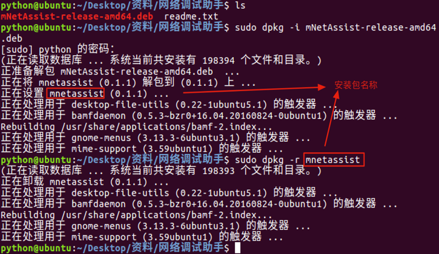
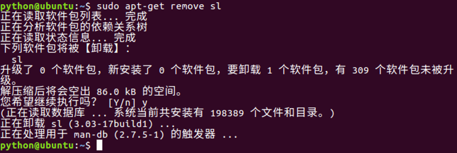

# 软件卸载

**学习目标**

-   能够使用apt-get命令卸载软件

* * *

### 1\. 软件卸载的介绍

Ubuntu软件卸载有两种方式:

-   离线安装包的卸载(deb 文件格式卸载）
-   在线安装包的卸载(apt-get 方式卸载)

### 2\. deb 文件格式卸载

**命令格式:**

**sudo dpkg –r 安装包名**

\-r 选项表示安装的卸载

**dpkg 卸载效果图:**

### 3\. apt-get 方式卸载

**命令格式:**

**sudo apt-get remove 安装包名**

**apt-get 卸载效果图:**

### 4\. 小结

-   Ubuntu 操作系统卸载软件有两种方式:
    -   **dpkg -r 安装包** 命令
    -   **apt-get remove 安装包** 命令卸载
