# 软件安装

**学习目标**

-   能够使用apt-get命令安装软件

* * *

### 1\. 软件安装的介绍

Ubuntu软件安装有两种方式:

-   离线安装(deb文件格式安装）
-   在线安装(apt-get方式安装)

### 2\. deb文件格式安装

是 Ubuntu 的安装包格式，可以使用 **dpkg** 命令进行软件的安装和卸载。

<html><head></head><body><table><thead><tr><th style="text-align:left">命令</th><th style="text-align:left">说明</th></tr></thead><tbody><tr><td style="text-align:left">dpkg</td><td style="text-align:left">安装和卸载deb安装包</td></tr></tbody></table></body></html>

**dpkg命令选项:**

<html><head></head><body><table><thead><tr><th style="text-align:left">选项</th><th style="text-align:left">说明</th></tr></thead><tbody><tr><td style="text-align:left">-i</td><td style="text-align:left">离线安装deb安装包</td></tr></tbody></table></body></html>

**dpkg命令效果图:**

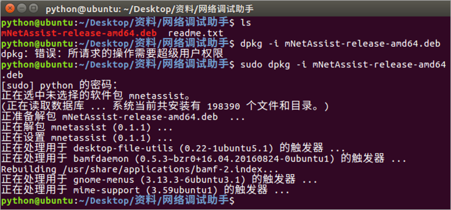

### 3\. apt-get方式安装

是在线安装deb软件包的命令，主要用于在线从互联网的软件仓库中**搜索、安装、升级、卸载**软件。

**在线安装软件命令格式:**

-   **sudo apt–get install 安装包** , 表示在线安装deb安装包

### 4\. 更改镜像源

因为使用 apt-get 命令默认是从国外的服务器下载安装软件的，会导致下载安装速度很慢，所以需要更改成国内的镜像源服务器。

**镜像源说明:**

镜像源就是下载软件来源的服务器。

**镜像源效果图:**

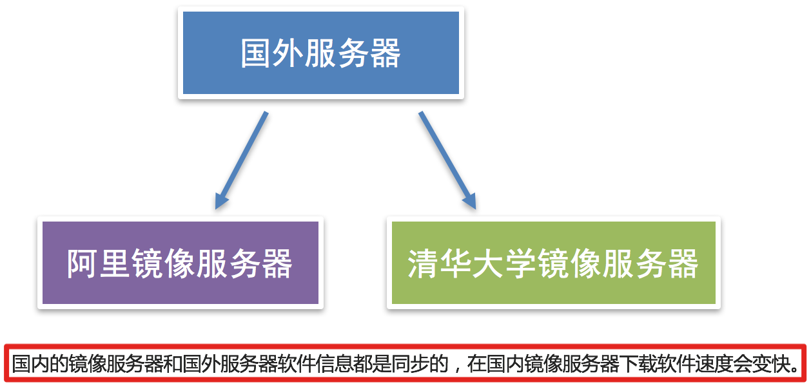

**更改镜像源的方式:**

1.  可视化方式更改镜像源
2.  手动方式更改镜像源

**可视化方式更改镜像源:**

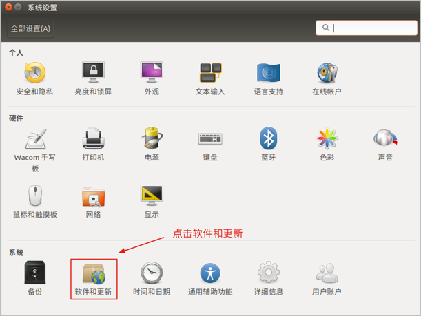 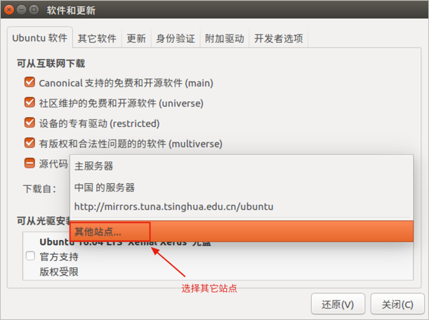 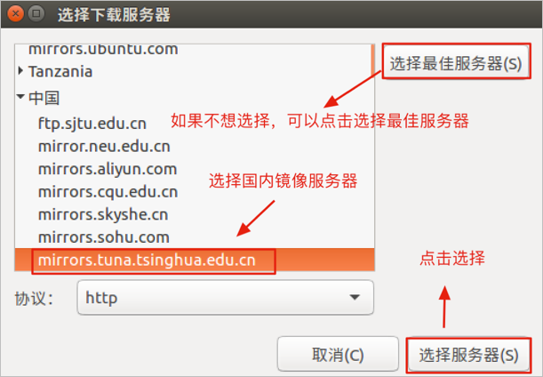 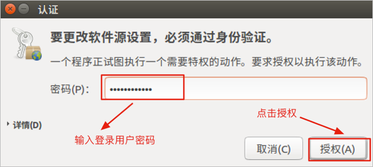 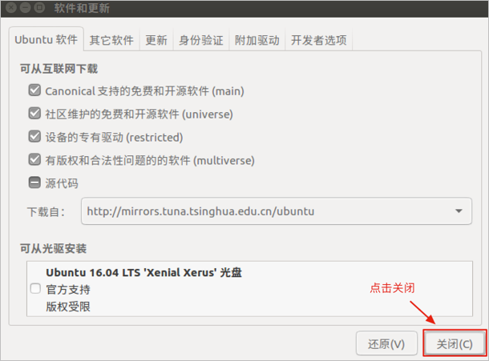 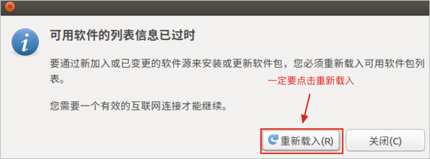 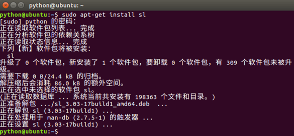

**手动方式更改镜像源:**

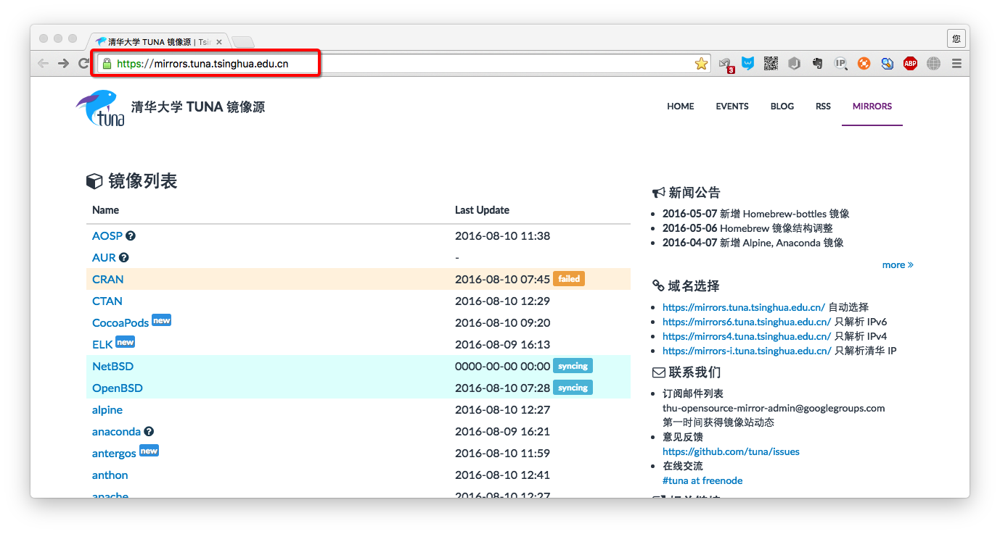 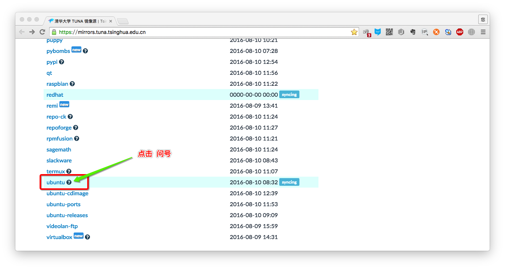 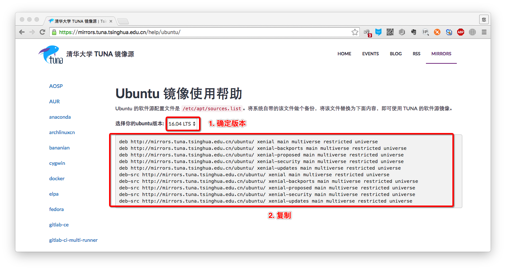 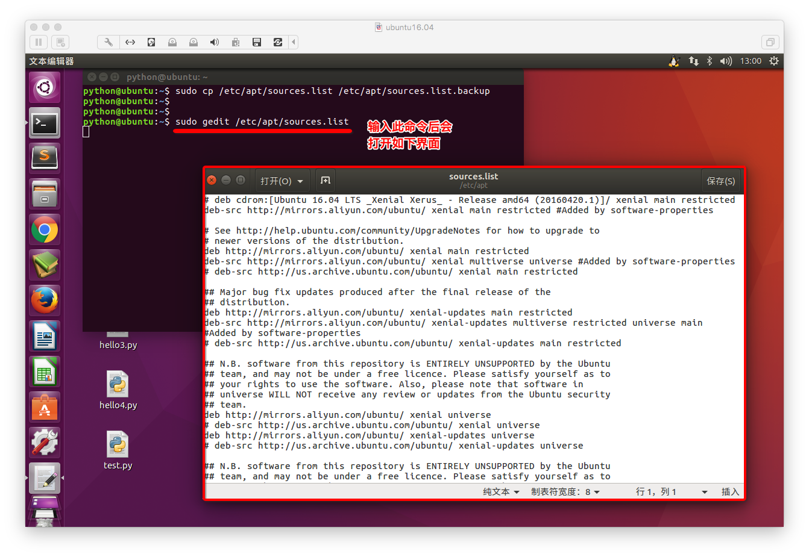 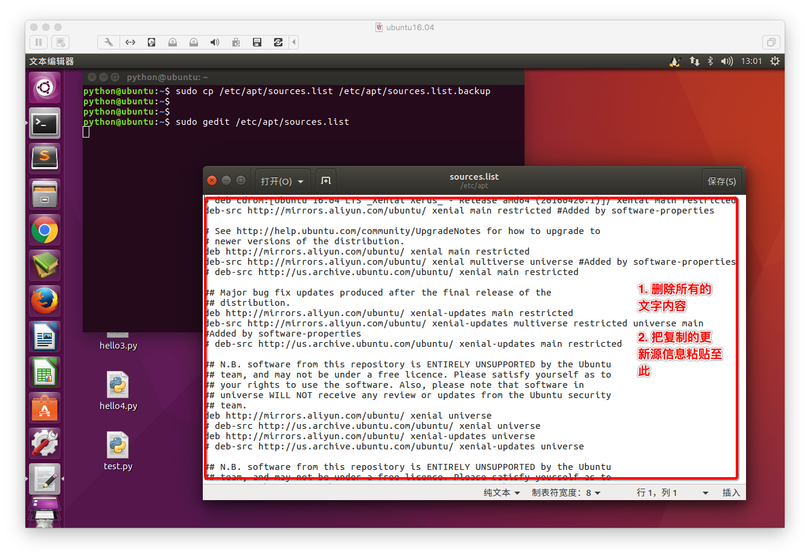 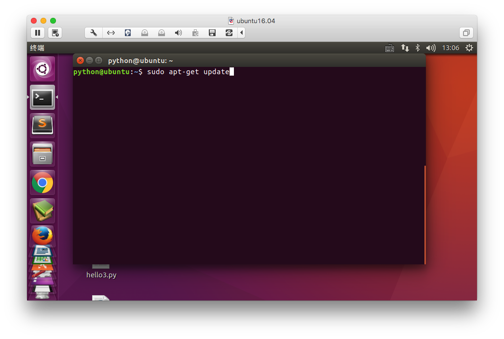 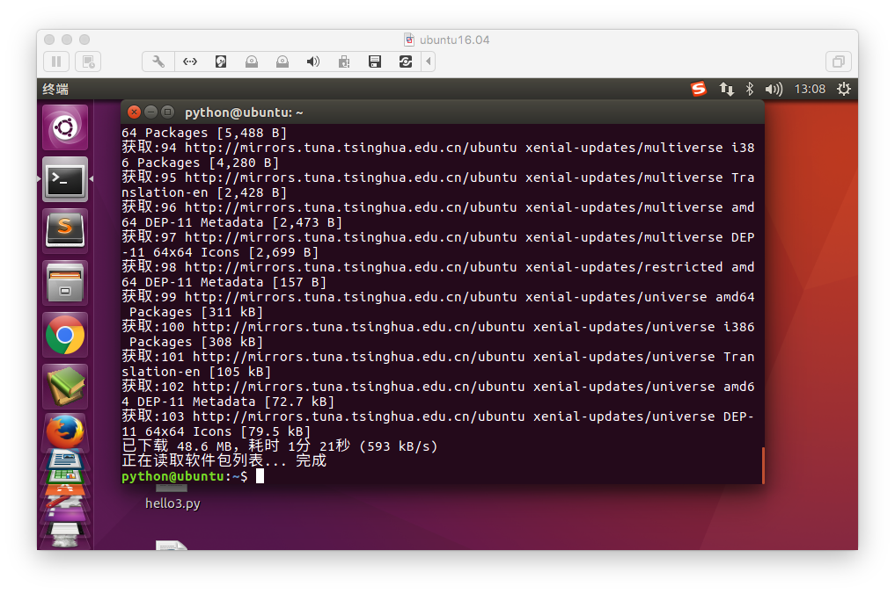

**说明:**

1.  手动修改镜像源，配置完成以后需要执行 **sudo apt-get update** 这个命令，更新镜像源保证可以下载最新的软件。
2.  **使用apt-get方式安装软件一定要联网**

### 5\. 小结

1.  Ubuntu 操作系统安装软件有两种方式:
    -   **sudo dpkg -i 安装包** 命令
    -   **sudo apt-get install 安装包** 命令卸载
2.  使用 **apt-get** 命令也就是在线安装需要更改镜像源，提高下载和安装速度。
