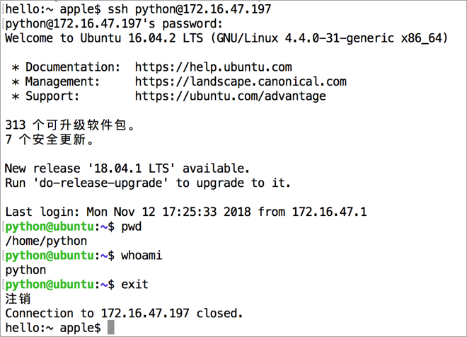
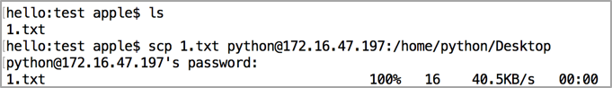
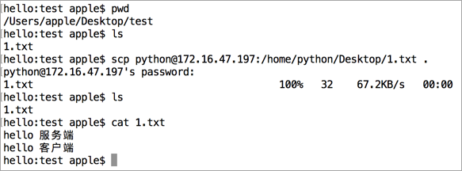
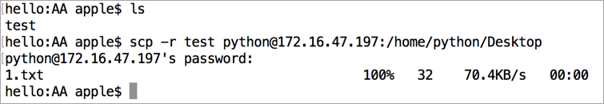
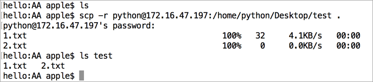
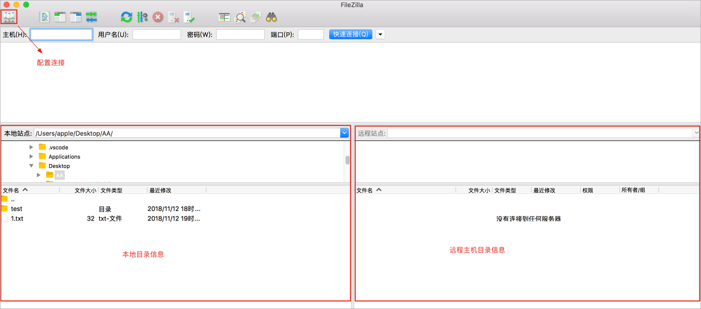
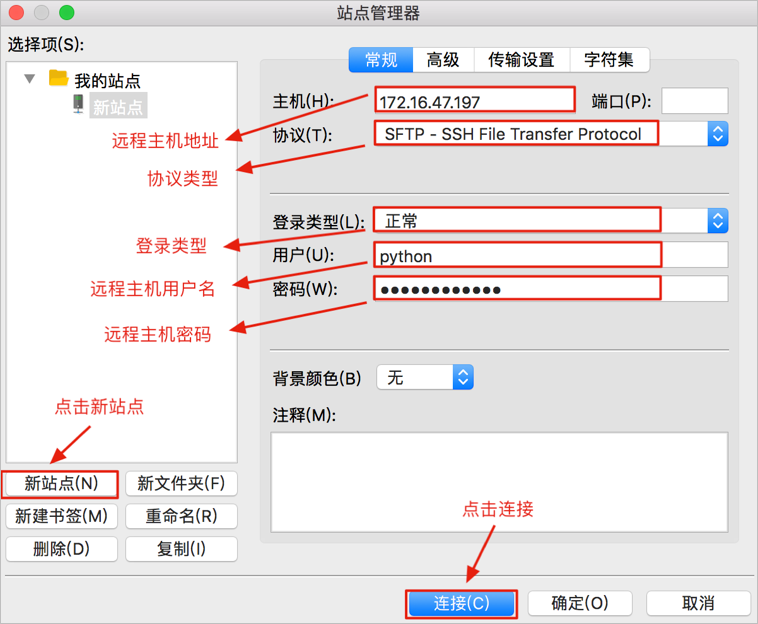
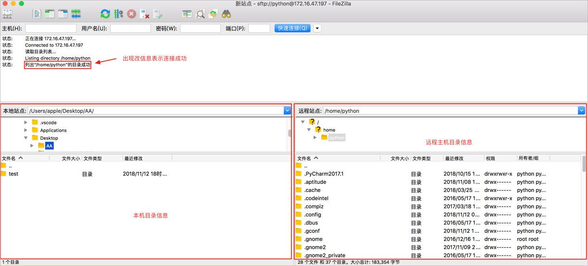
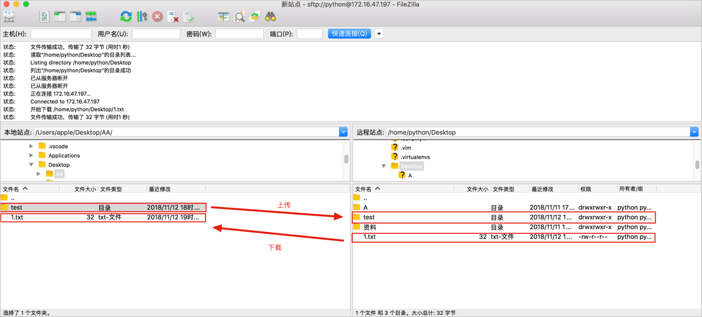

# 远程登录、远程拷贝命令

**学习目标**

-   能够写出远程拷贝、远程登录命令

* * *

### 1\. 远程登录、远程拷贝命令的介绍

<html><head></head><body><table><thead><tr><th style="text-align:left">命令</th><th style="text-align:left">说明</th></tr></thead><tbody><tr><td style="text-align:left">ssh</td><td style="text-align:left">远程登录</td></tr><tr><td style="text-align:left">scp</td><td style="text-align:left">远程拷贝</td></tr></tbody></table></body></html>

### 2\. ssh命令的使用

ssh是专门为远程登录提供的一个安全性协议，常用于远程登录，想要使用ssh服务，需要安装相应的服务端和客户端软件，当软件安装成功以后就可以使用ssh命令了，以后可以通过远程登录之间操作远程的服务器。

**远程登录效果图:**

**软件安装步骤:**

1.  假如Ubuntu作为服务端,需要安装ssh服务端软件. 执行命令: **sudo apt-get install openssh-server**
2.  客户端电脑如果是 **macOS** 系统则不需要安装 ssh 客户端软件，默认已经安装过了，**直接可以使用 ssh 命令**
3.  客户端电脑如果是Windows系统则需要安装**OpenSSH for Windows**这个软件

**ssh命令格式:**

ssh 用户名@ip地址

**ssh命令效果图:**

**说明:**

-   在一台电脑上可以安装安装ssh客户端和ssh服务端软件
-   在Ubuntu安装ssh客户端命令: sudo apt-get install openssh-client

### 3\. scp命令的使用

scp是基于ssh进行远程文件拷贝的命令，也就是说需要保证服务端和客户端电脑安装了相应的ssh软件，以后可以把我们写代码远程拷贝到服务器。

**scp命令格式:**

-   远程拷贝文件
    -   scp 本地文件 远程服务器用户名@远程服务器ip地址:指定拷贝到远程服务器的路径
    -   scp 远程服务器用户名@远程服务器ip地址:远程服务器文件 指定拷贝到本地电脑的路径
-   远程拷贝目标
    -   scp -r 本地目录 远程服务器用户名@远程服务器ip地址:指定拷贝到远程服务器的路径
    -   scp -r 远程服务器用户名@远程服务器ip地址:远程服务器目录 指定拷贝到本地电脑的路径
    -   \-r 表示递归拷贝整个目录

**本地文件远程拷贝到服务器效果图:**

**服务器文件远程拷贝到本地效果图:**

**本地目录远程拷贝到服务器效果图:**

**服务器目录远程拷贝到本地效果图:**

### 4\. FileZilla软件的使用

FileZilla 是一个免费开源的FTP软件, 使用可视化方式进行上传和下载文件。以后可以通过 FileZilla 来代替 **scp** 命令

**FileZilla使用效果图:**

   

### 5\. 小结

-   ssh命令是远程登录主机电脑，相当于直接操作的是远程电脑。
-   scp命令是可以完成远程拷贝操作，注意:拷贝文件夹需要加-r选项。
-   大量的文件上传和下载可以通过可视化工具FileZilla来完成。
