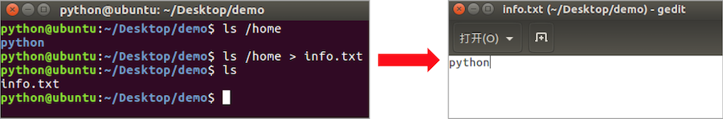
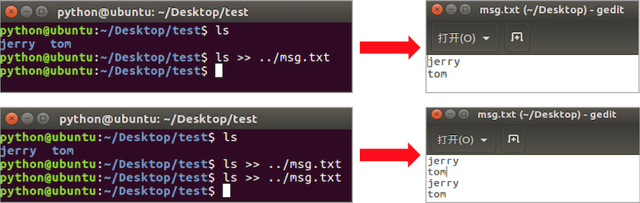

# 重定向命令

**学习目标**

-   能够使用重定向命令将终端显示内容重定向到文件

* * *

### 1\. 重定向命令的介绍

重定向也称为输出重定向，把在终端执行命令的结果保存到目标文件。

### 2\. 重定向命令的使用

<html><head></head><body><table><thead><tr><th style="text-align:left">命令</th><th style="text-align:left">说明</th></tr></thead><tbody><tr><td style="text-align:left">&gt;</td><td style="text-align:left">如果文件存在会覆盖原有文件内容，相当于文件操作中的‘w’模式</td></tr><tr><td style="text-align:left">&gt;&gt;</td><td style="text-align:left">如果文件存在会追加写入文件末尾，相当于文件操作中的‘a’ 模式</td></tr></tbody></table></body></html>

**重定向命令效果图:**

**说明:**

只要在终端能显示信息的命令都可以使用重定向，比如: tree

### 3\. 小结

-   终端内容保存到文件使用重定向有两种方式: **\>** 和 **\>>**
-   **\>** 表示每次只写入最新的数据，原有数据不保留。
-   **\>>** 表示每次在原有数据的基础上进行追加，原有数据会保留。
