# 链接命令

**学习目标**

-   能够说出软链接的创建方式
-   能够说出硬链接的创建方式

* * *

### 1\. 链接命令的介绍

链接命令是创建链接文件，链接文件分为:

-   软链接
-   硬链接

<html><head></head><body><table><thead><tr><th style="text-align:left">命令</th><th style="text-align:left">说明</th></tr></thead><tbody><tr><td style="text-align:left">ln -s</td><td style="text-align:left">创建软链接</td></tr><tr><td style="text-align:left">ln</td><td style="text-align:left">创建硬链接</td></tr></tbody></table></body></html>

### 2\. 软链接

类似于**Windows下的快捷方式**，当一个源文件的目录层级比较深，我们想要方便使用它可以给源文件创建一个软链接。

**软链接效果图:**

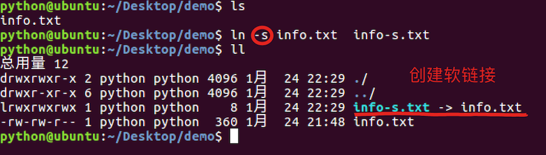  
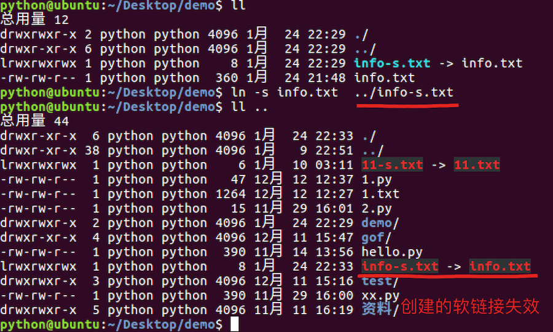  
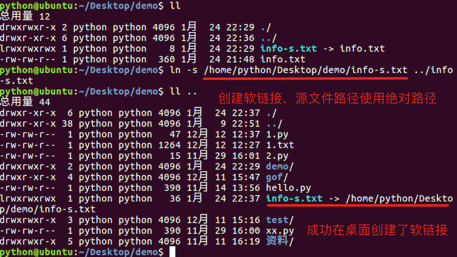  
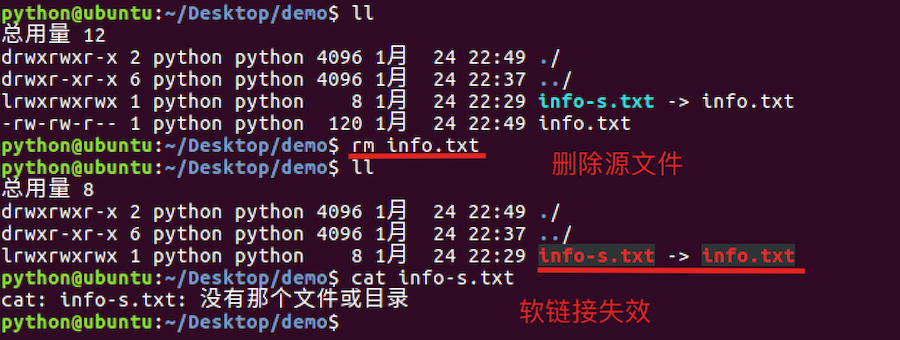  
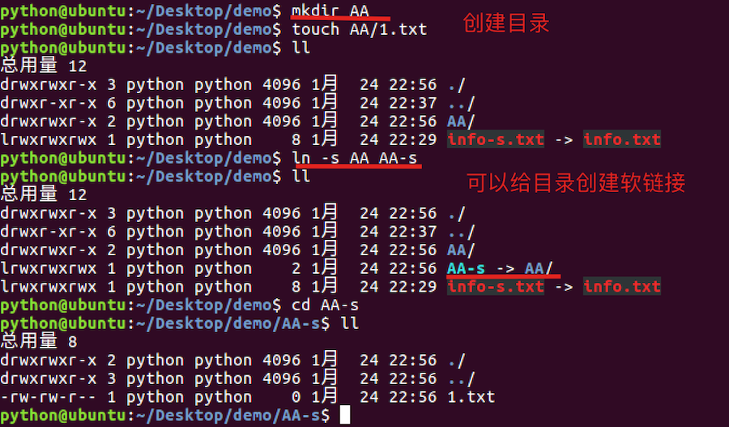

**注意点:**

-   **如果软链接和源文件不在同一个目录，源文件要使用绝对路径，不能使用相对路径。**
-   **删除源文件则软链接失效**
-   **可以给目录创建软链接**

### 3\. 软链接小结

-   软链接的作用是方便文件的快速访问，比如:给一个复杂路径下的文件创建一个软链接，以后就可以通过软链接完成快速访问操作。
-   创建软链接命令格式: ln -s 源文件路径(使用绝对路径) 软链接

### 4\. 硬链接

类似于**源文件的一个别名**，也就是说这两个名字指向的是同一个文件数据。

**硬链接效果图:**

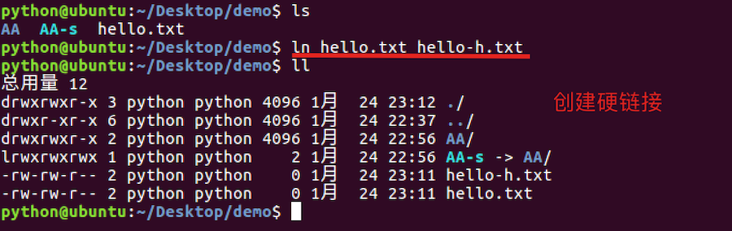  
  
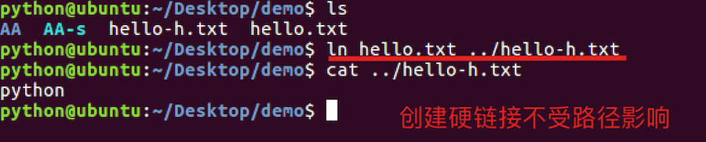  
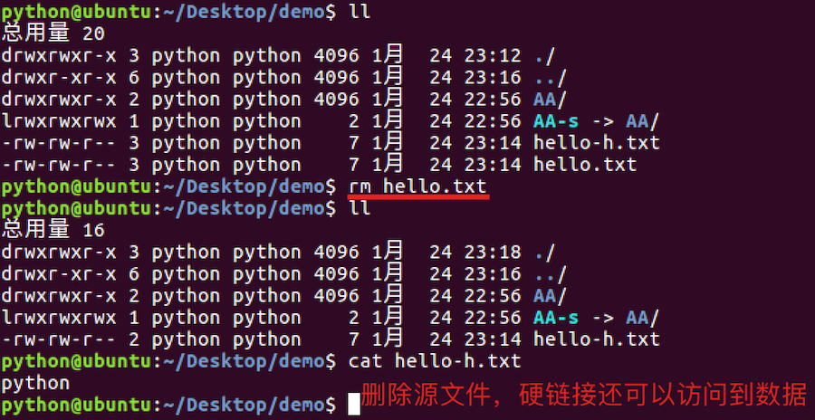  
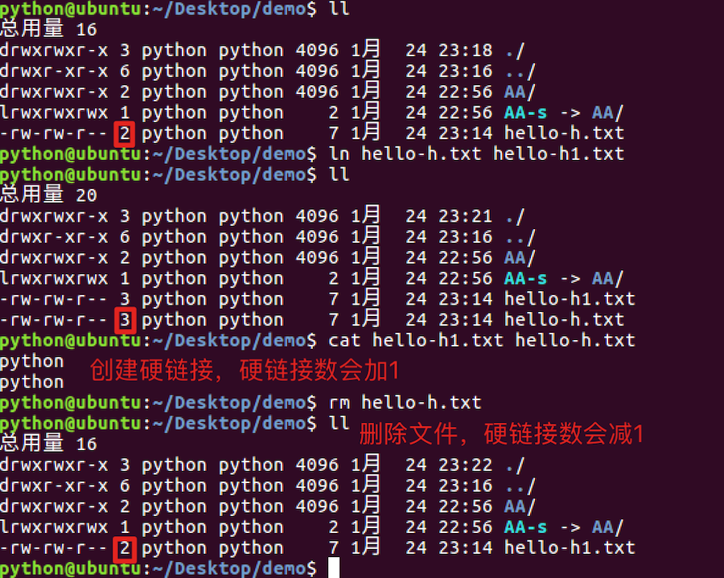  
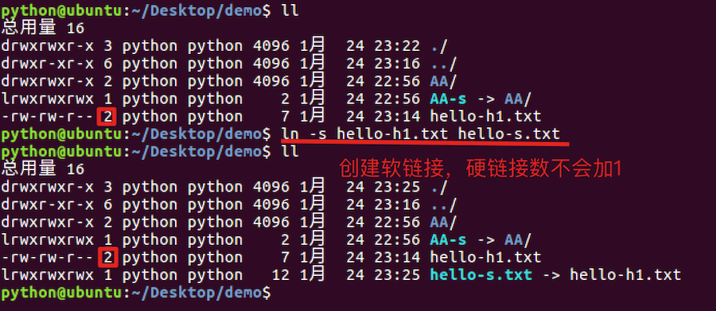  
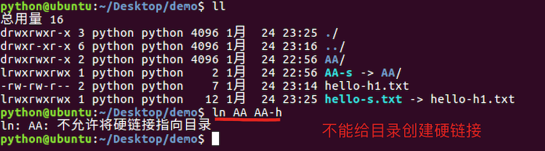

**注意点:**

-   **创建硬链接使用相对路径和绝对路径都可以**
-   **删除源文件，硬链接还可以访问到数据。**
-   **创建硬链接，硬链接数会加1，删除源文件或者硬链接，硬链接数会减1。**
-   **创建软链接，硬链接数不会加1**
-   **不能给目录创建硬链接**

**硬链接数:**

**硬链接数就是文件数据被文件名使用的次数, 好比引用计数**

### 5\. 硬链接小结

-   硬链接的作用是可以给重要文件创建硬链接，能够防止文件数据被误删。
-   删除源文件，软链接失效，但是硬链接依然可以使用。
-   创建硬链接命令格式: ln 源文件路径 硬链接
