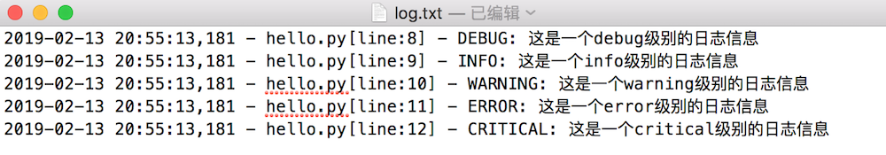

# logging日志

**学习目标**

-   能够知道logging日志的使用

* * *

### 1\. logging日志的介绍

在现实生活中，记录日志非常重要，比如:银行转账时会有转账记录；飞机飞行过程中，会有个黑盒子（飞行数据记录器）记录着飞机的飞行过程，那在咱们python程序中想要记录程序在运行时所产生的日志信息，怎么做呢?

可以使用 **logging** 这个包来完成

**记录程序日志信息的目的是:**

1.  可以很方便的了解程序的运行情况
2.  可以分析用户的操作行为、喜好等信息
3.  方便开发人员检查bug

### 2\. logging日志级别介绍

日志等级可以分为5个，从低到高分别是:

1.  DEBUG
2.  INFO
3.  WARNING
4.  ERROR
5.  CRITICAL

**日志等级说明:**

-   DEBUG：程序调试bug时使用
-   INFO：程序正常运行时使用
-   WARNING：程序未按预期运行时使用，但并不是错误，如:用户登录密码错误
-   ERROR：程序出错误时使用，如:IO操作失败
-   CRITICAL：特别严重的问题，导致程序不能再继续运行时使用，如:磁盘空间为空，一般很少使用
-   默认的是WARNING等级，当在WARNING或WARNING之上等级的才记录日志信息。
-   日志等级从低到高的顺序是: DEBUG < INFO < WARNING < ERROR < CRITICAL

### 3\. logging日志的使用

在 logging 包中记录日志的方式有两种:

1.  输出到控制台
2.  保存到日志文件

**日志信息输出到控制台的示例代码:**

```py
import logging

logging.debug('这是一个debug级别的日志信息')
logging.info('这是一个info级别的日志信息')
logging.warning('这是一个warning级别的日志信息')
logging.error('这是一个error级别的日志信息')
logging.critical('这是一个critical级别的日志信息')
```

**运行结果:**

```py
WARNING:root:这是一个warning级别的日志信息
ERROR:root:这是一个error级别的日志信息
CRITICAL:root:这是一个critical级别的日志信息
```

**说明:**

-   日志信息只显示了大于等于WARNING级别的日志，这说明默认的日志级别设置为WARNING

**logging日志等级和输出格式的设置:**

```py
import logging

# 设置日志等级和输出日志格式
logging.basicConfig(level=logging.DEBUG,
                    format='%(asctime)s - %(filename)s[line:%(lineno)d] - %(levelname)s: %(message)s')

logging.debug('这是一个debug级别的日志信息')
logging.info('这是一个info级别的日志信息')
logging.warning('这是一个warning级别的日志信息')
logging.error('这是一个error级别的日志信息')
logging.critical('这是一个critical级别的日志信息')
```

**运行结果:**

```py
2019-02-13 20:41:33,080 - hello.py[line:6] - DEBUG: 这是一个debug级别的日志信息
2019-02-13 20:41:33,080 - hello.py[line:7] - INFO: 这是一个info级别的日志信息
2019-02-13 20:41:33,080 - hello.py[line:8] - WARNING: 这是一个warning级别的日志信息
2019-02-13 20:41:33,080 - hello.py[line:9] - ERROR: 这是一个error级别的日志信息
2019-02-13 20:41:33,080 - hello.py[line:10] - CRITICAL: 这是一个critical级别的日志信息
```

**代码说明:**

-   level 表示设置的日志等级
-   format 表示日志的输出格式, 参数说明:
    -   %(levelname)s: 打印日志级别名称
    -   %(filename)s: 打印当前执行程序名
    -   %(lineno)d: 打印日志的当前行号
    -   %(asctime)s: 打印日志的时间
    -   %(message)s: 打印日志信息

**日志信息保存到日志文件的示例代码:**

```py
import logging

logging.basicConfig(level=logging.DEBUG,
                    format='%(asctime)s - %(filename)s[line:%(lineno)d] - %(levelname)s: %(message)s',
                    filename="log.txt",
                    filemode="w")

logging.debug('这是一个debug级别的日志信息')
logging.info('这是一个info级别的日志信息')
logging.warning('这是一个warning级别的日志信息')
logging.error('这是一个error级别的日志信息')
logging.critical('这是一个critical级别的日志信息')
```

**运行结果:**



### 4\. logging日志在mini-web项目中应用

**web.py 程序使用logging日志示例:**

1.  程序入口模块设置logging日志的设置
    
    ```py
     import socket
     import threading
     import sys
     import framework
     import logging
    
     # logging日志的配置
     logging.basicConfig(level=logging.DEBUG,
                         format='%(asctime)s - %(filename)s[line:%(lineno)d] - %(levelname)s: %(message)s',
                         filename="log.txt",
                         filemode="w")
    ```
    
2.  INFO级别的日志输出，示例代码:
    
    ```py
     # 判断是否是动态资源请求
     if request_path.endswith(".html"):
         """这里是动态资源请求，把请求信息交给框架处理"""
         logging.info("动态资源请求:" + request_path)
         ...
     else:
         """这里是静态资源请求"""
         logging.info("静态资源请求:" + request_path)
         ...
    ```
    
3.  WARNING级别的日志输出，示例代码:
    
    ```py
     # 获取命令行参数判断长度
     if len(sys.argv) != 2:
         print("执行命令如下: python3 xxx.py 9000")
         logging.warning("用户在命令行启动程序参数个数不正确!")
         return
    
     # 判断端口号是否是数字
     if not sys.argv[1].isdigit():
         print("执行命令如下: python3 xxx.py 9000")
         logging.warning("用户在命令行启动程序参数不是数字字符串!")
         return
    ```
    

**framework.py 程序使用logging日志示例:**

1.  ERROR级别的日志输出，示例代码:
    
    ```py
     # 处理动态资源请求
     def handle_request(env):
         # 获取动态请求资源路径
         request_path = env["request_path"]
         print("接收到的动态资源请求:", request_path)
         # 遍历路由列表，选择执行的函数
         for path, func in route_list:
             if request_path == path:
                 result = func()
                 return result
         else:
             logging.error("没有设置相应的路由:" + request_path)
             # 没有找到动态资源
             result = not_found()
             return result
    ```
    

**说明:**

-   logging日志配置信息在程序入口模块设置一次，整个程序都可以生效。
    -   logging.basicConfig 表示 logging 日志配置操作

### 5\. 小结

-   记录python程序中日志信息使用 logging 包来完成
-   logging日志等级有5个:
    
    1.  DEBUG
    2.  INFO
    3.  WARNING
    4.  ERROR
    5.  CRITICAL
-   打印(记录)日志的函数有5个:
    
    1.  logging.debug函数, 表示: 打印(记录)DEBUG级别的日志信息
    2.  logging.info函数, 表示: 打印(记录)INFO级别的日志信息
    3.  logging.warning函数, 表示: 打印(记录)WARNING级别的日志信息
    4.  logging.error函数, 表示: 打印(记录)ERROR级别的日志信息
    5.  logging.critical函数, 表示: 打印(记录)CRITICAL级别的日志信息
