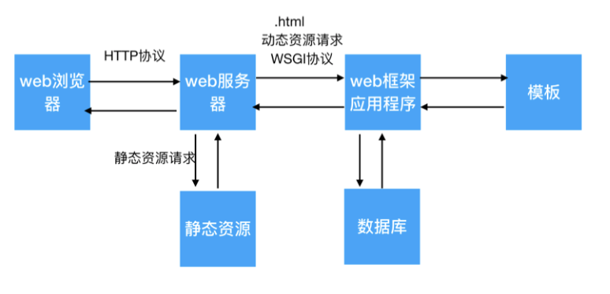

# web框架概述

**学习目标**

-   能够知道web框架和web服务器的关系

* * *

### 1\. web框架和web服务器的关系介绍

前面已经学习过web服务器, 我们知道web服务器主要是接收用户的http请求,根据用户的请求返回不同的资源数据，但是之前我们开发的是静态web服务器，返回的都是静态资源数据，假如我们想要web服务器返回动态资源那么该如何进行处理呢？

这里我们给大家介绍一个web框架，**使用web框架专门负责处理用户的动态资源请求，这个web框架其实就是一个为web服务器提供服务的应用程序**，简称web框架。

**关系说明:**

-   web服务器接收浏览器发起的请求，如果是动态资源请求找web框架来处理
-   web框架负责处理浏览器的动态资源请求，把处理的结果发生给web服务器
-   web服务器再把响应结果发生给浏览器

### 2\. 静态资源

不需要经常变化的资源，这种资源web服务器可以提前准备好，比如: png/jpg/css/js等文件。

### 3\. 动态资源

和静态资源相反, 这种资源会经常变化，比如: 我们在京东浏览商品时经常会根据条件进行筛选，选择不同条件, 浏览的商品就不同，这种资源web服务器无法提前准备好，需要web框架来帮web服务器进行准备，在这里web服务器可以把.html的资源请求认为是动态资源请求交由web框架进行处理。

### 4\. WSGI协议

它是web服务器和web框架之间进行协同工作的一个规则，WSGI协议规定web服务器把动态资源的请求信息传给web框架处理，web框架把处理好的结果返回给web服务器。

### 5\. 小结

-   web框架是专门为web服务器处理动态资源请求的一个应用程序
-   web框架和web服务器的关系是web框架专门服务于web服务器，给web服务器提供处理动态资源请求的服务。
